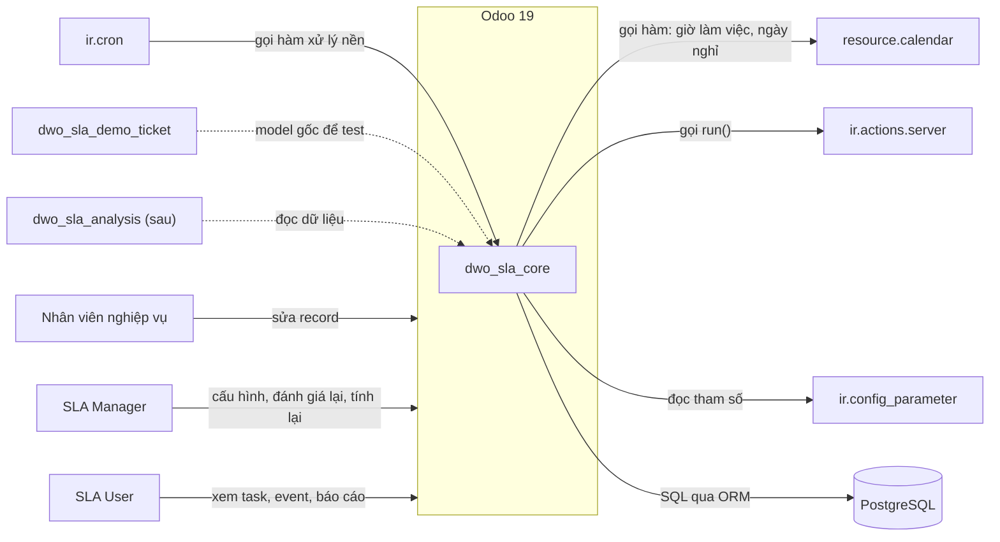
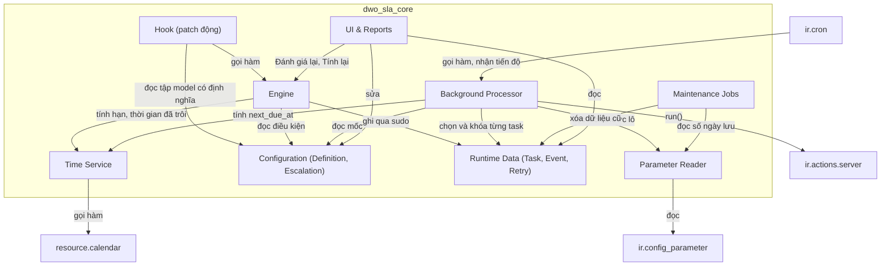
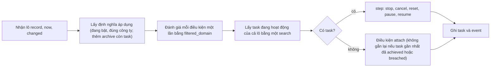
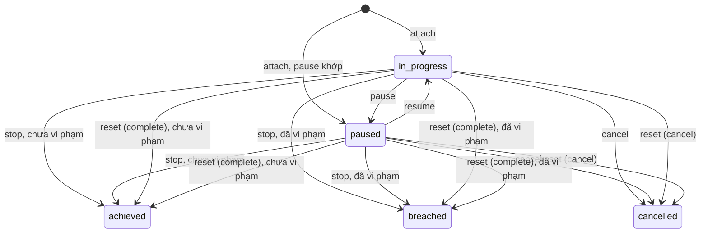
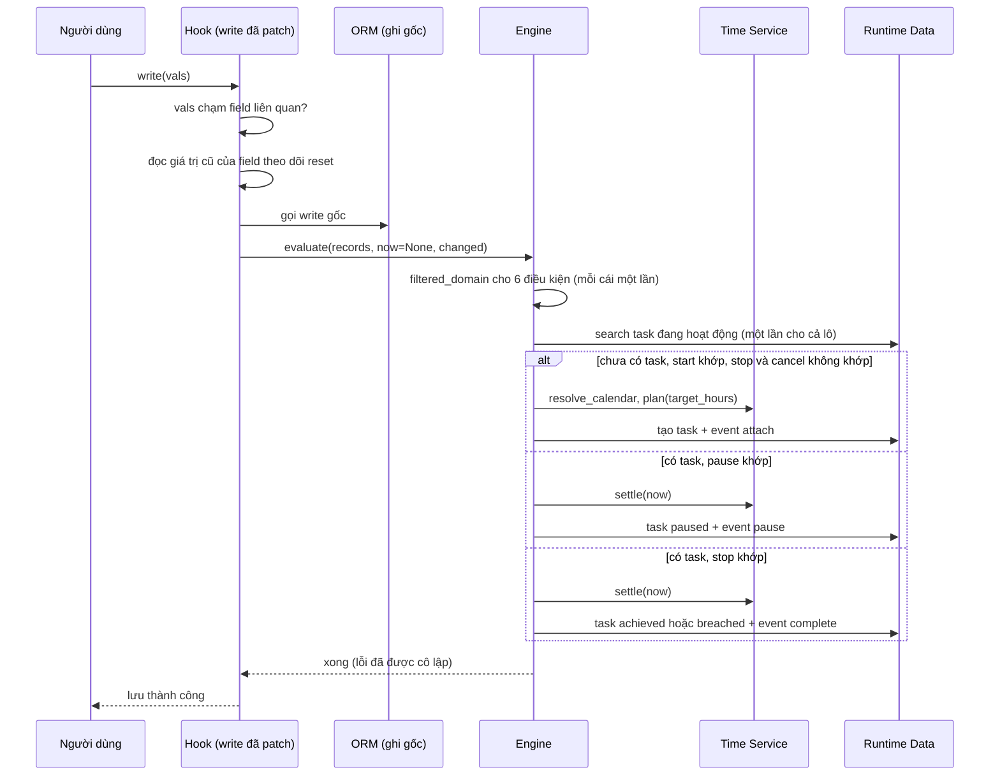
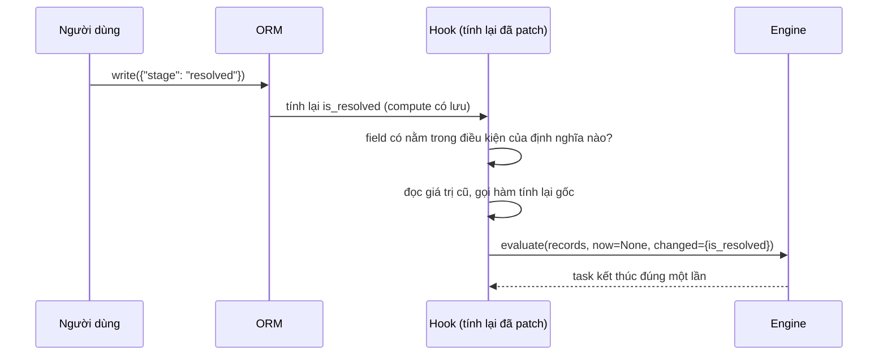
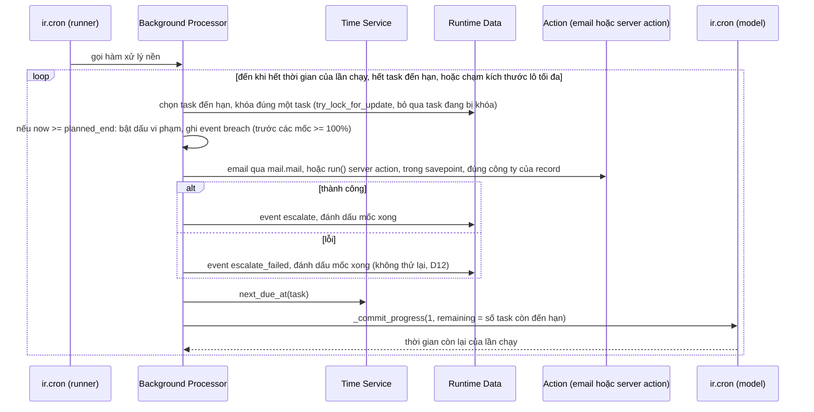
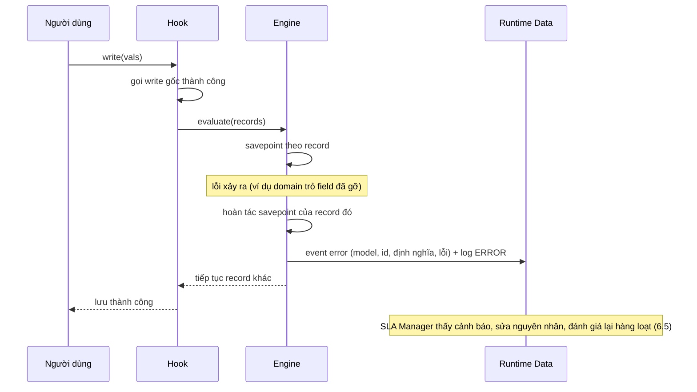
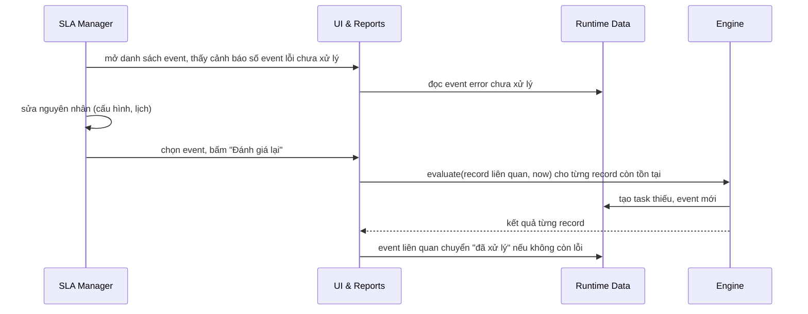
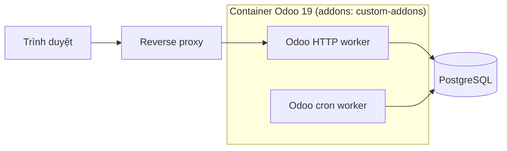

# Technical Architecture Document

## Cho module `dwo_sla_core` (SLA generic cho Odoo 19)

Version 0.3 (draft)
Prepared by hieudt
DUO-TEK Software Vietnam
2026-10-12

| Version | Date | Author | Changes |
|---------|------|--------|---------|
| 0.1 | 2026-10-09 | hieudt | Khởi tạo từ SRS 0.2 và bản thiết kế `.claude/plans/010_SLA.md` |
| 0.2 | 2026-10-09 | hieudt | Sửa theo review TAD: AD-01 chuyển sang patch động trong `_register_hook` chỉ trên model có định nghĩa; sửa AD-12 (cơ chế `ir.cron` đọc đúng theo source, khóa và lưu từng task); bỏ làm mất `ormcache` theo từng task; thêm AD-13 (mô hình quyền); thêm kịch bản 6.5, whitebox L2; sửa 1.2, 1.3, 3, 5.1, 7.2, 11, 12 |
| 0.3 | 2026-10-12 | hieudt | Đối chiếu với code và SRS 0.4: K-02 ghi thêm `web` (D1); 1.2 và 7.2 sửa ngưỡng REQ-PERF-001 (5%, đã chốt O-01) áp cho model KHÔNG có định nghĩa; 1.2 nhóm TG-01 đến TG-19; 5.1 và 6.1 hook gọi `evaluate(records, now=None, changed)`; AD-06 thêm cờ `cancel_retry_on_stop` và bước xử lý lượt thử lại của task không còn `in_progress`; AD-12 nêu tên 3 tham số cấu hình; tham chiếu Phụ lục 060 dùng tiền tố `TA-`; trỏ `docs/TASKS.md` |
| 0.4 | 2026-11-07 | hieudt | D12/D13: AD-06 đánh dấu Superseded by AD-14 (bỏ bảng thử lại, giữ phần khóa từng task); thêm AD-14 (bỏ `sla.escalation.retry`, mặc định escalation = email qua `mail.mail`, server action vẫn có cho nâng cao); kịch bản 6.3 và §8.2 viết lại không còn nhánh thử lại. |
| 0.5 | 2026-11-12 | hieudt | Đợt cải thiện 01 (19.0.1.1.0): thêm mục 5.4 (thành phần mới: `sla.apply.job`, `sla.apply.wizard`, `ir.http`, chip trạng thái và controller form định nghĩa), 6.6 (kịch bản Apply to Existing Records), 8.9 (nâng cấp và tương thích). |

---

## 0. Thông tin chung

- **Hệ thống (System of Interest):** `dwo_sla_core`, module Odoo 19 cung cấp SLA dùng chung cho model bất kỳ. Module demo `dwo_sla_demo_ticket` chỉ là một model gốc dùng để test.
- **SRS tham chiếu:** `010_Software-Requirements-Specification.md`, version 0.4 (REQ-ID trong tài liệu này theo version đó).
- **Phạm vi:** kiến trúc của `dwo_sla_core`: hook, engine, tính thời gian, xử lý nền (escalation), mô hình dữ liệu ở mức khối. Không bao gồm: SLO và dashboard (`dwo_sla_analysis`, giai đoạn sau), sản phẩm helpdesk, giao diện chi tiết. Chi tiết bảng và index nằm ở `030_Database-Design.md`.

---

## 1. Introduction & Goals

### 1.1 Requirements Overview

Chỉ liệt kê yêu cầu có ảnh hưởng tới kiến trúc:

| Nhóm | Yêu cầu (SRS) | Tác động kiến trúc |
|------|---------------|--------------------|
| Gắn SLA vào model bất kỳ bằng cấu hình | REQ-FUNC-001, 002, REQ-INST-003 | Quan sát mọi model có định nghĩa mà không thêm cột vào bảng của chúng: hook chung chỉ gắn vào model có định nghĩa, bảng riêng. |
| Đánh giá khi tạo, sửa và khi field compute có lưu đổi | REQ-FUNC-004, 005, 013 | Hook ở `create`, `write` và hàm tính lại field; cần biết field nào vừa đổi giá trị. |
| 6 điều kiện, thứ tự ưu tiên, idempotent | REQ-FUNC-006 đến 016 | Engine thuần, test được không cần qua `create`/`write`. |
| Tính giờ làm việc, pause, resume, snapshot | REQ-FUNC-018, 019, 020, 021, 043, 044, 052 | Lưu thời gian đã trôi (không lưu thời gian còn lại); giao tính lịch cho `resource.calendar`; 3 nguồn lịch và lịch dự phòng. |
| Retroactive start | REQ-FUNC-017, 041 | Time Service lấy mốc bắt đầu từ field ngày giờ. |
| Escalation, retry, đúng một lần, không bắn bù | REQ-FUNC-023 đến 028, 053 đến 059 | Xử lý nền theo mốc, khóa từng task, bảng lượt thử lại. |
| Engine lỗi không chặn lưu record | REQ-FUNC-030, 031, 040 | Cô lập lỗi bằng savepoint, ghi event `error`. |
| Báo cáo cơ bản | REQ-FUNC-036, 062, REQ-INT-011 đến 013, 023 | Chỉ mục riêng cho truy vấn tổng hợp (xem 030). |
| Hiệu năng của hook trên mọi model | REQ-PERF-001 đến 003 | Patch chỉ model có định nghĩa; xử lý theo lô và theo mốc. |
| Đồng thời và an toàn | REQ-FUNC-014, REQ-REL-001, 002 | Ràng buộc duy nhất ở mức database; khóa từng task; báo tiến độ cho `ir.cron`. |
| Quyền và đa công ty | REQ-SEC-001 đến 006, REQ-INT-019 | Ghi dữ liệu SLA bằng quyền hệ thống ở điểm ghi hẹp; record rule theo công ty; user cron cần quyền công ty (AD-13). |
| Tham số và vận hành | REQ-INT-010, 012, REQ-FUNC-034, 035, REQ-OBS-001 đến 003 | Đọc `ir.config_parameter`; job dọn dẹp; log và event lỗi. |
| Mở rộng không sửa module | REQ-INT-007, 015 đến 018, REQ-REUSE-001 | Mọi giá trị engine cần đều đi qua phương thức ghi đè được. |

### 1.2 Quality Goals

| Ưu tiên | Quality goal | Scenario đo được | Chi tiết |
|---------|--------------|------------------|----------|
| 1 | Độ đúng của đo SLA | Đánh giá hai lần liên tiếp không đổi kết quả; mọi ca nhóm TG-01 đến TG-19 đạt | QS-01, QS-02 |
| 2 | Không chặn nghiệp vụ | Lỗi engine không làm lưu record thất bại; lần lưu không chờ khóa của xử lý nền quá 5 giây (p95), kể cả khi lưu chính task đang được xử lý | QS-03, QS-04 |
| 3 | Overhead thấp | Model không có định nghĩa không bị ảnh hưởng (không bị patch); model KHÔNG có định nghĩa chậm không quá ngưỡng ở REQ-PERF-001 (5%, đã chốt O-01); model có định nghĩa chịu chi phí hook, đo ở REQ-PERF-002, REQ-PERF-003 | QS-05, QS-06 |
| 4 | Mở rộng được | Module mẫu thêm nguồn lịch mà không sửa `dwo_sla_core` | QS-07 |
| 5 | Độ trễ và tải của xử lý nền | Mốc và vi phạm được xử lý trong 2 phút (p95); một lần chạy cron không chiếm worker vượt giới hạn thời gian của Odoo | QS-08, QS-09 |
| 6 | An toàn dữ liệu và quyền | Người dùng không có quyền không thấy dữ liệu SLA của công ty khác; gỡ module sạch; patch của module không bị mất | QS-10, QS-11, QS-12 |

### 1.3 Stakeholders & Concerns

| Stakeholder | Vai trò | Concern chính | View giải quyết |
|-------------|---------|---------------|-----------------|
| SLA Manager | Cấu hình SLA, xử lý event lỗi | Cấu hình đúng hành vi; biết khi SLA lỗi; đánh giá lại được | 5.1 (Configuration, UI), 6.4, 6.5 |
| SLA User | Xem task, báo cáo | Kết quả đo đúng và truy vết được (`sla.event`) | 5.2, 6.1, 6.2, 8.2 |
| Nhân viên nghiệp vụ | Sửa record gốc | Không bị chậm, không bị lỗi vì SLA | 6.4, 8.3, AD-01, AD-07 |
| Developer module khác | Mở rộng, viết định nghĩa cho model mới | Điểm mở rộng ổn định, dễ test | 5.1, 8.6 |
| QA | Kiểm thử | Biết test gì ở đâu; engine test trực tiếp được | 5.2, 6, 8.7, 10 |
| DevOps / vận hành | Triển khai, giám sát | Không thêm dịch vụ; cron và dọn dẹp rõ ràng; cài, gỡ sạch; chiếm worker cron có giới hạn | 6.3, 7, 8.2, AD-09, AD-12 |
| Bảo mật / Compliance | Quyền ghi bằng `sudo`, cô lập đa công ty, chấp nhận SLA có thể thiếu | Phạm vi `sudo` hẹp; công ty; biết rủi ro SLA thiếu | 8.1, AD-07, AD-13, 11 |

---

## 2. Architecture Constraints

| ID | Ràng buộc | Loại | Nguồn / Lý do | Link ADR |
|----|----------|------|---------------|----------|
| K-01 | Odoo 19 (image `odoo:19.0-20260421`) và PostgreSQL; không vendoring core | Technical | CLAUDE.md của repo; SRS C-01 | AD-01 |
| K-02 | Chỉ phụ thuộc `base`, `resource` và `web` (D1, cho view); không OCA, không Helpdesk của Odoo | Technical | SRS C-02, REQ-INST-002 | AD-01 |
| K-03 | Không thêm cột vào bảng của model được gắn SLA | Technical | SRS C-03, REQ-INST-003 | AD-02 |
| K-04 | Giờ làm việc tính bằng `resource.calendar`; Datetime lưu UTC | Technical | SRS C-05 | AD-04 |
| K-05 | Hành vi 6 điều kiện theo ServiceNow đã chốt | Organizational | SRS C-04 | (hành vi ở SRS; engine ở AD-03) |
| K-06 | Module đặt trong `custom-addons/`, tiền tố `dwo_`, lint pylint ≥ 9 | Convention | CLAUDE.md; REQ-BUILD-001 | không |
| K-07 | Server action của escalation chạy bằng user của cron | Technical | SRS C-08 | AD-06, AD-13 |
| K-08 | Hỗ trợ đa công ty trong thiết kế | Organizational | SRS C-07 | AD-13 |

---

## 3. Context & Scope

### 3.1 Business Context

Chú giải: mũi tên liền là luồng gọi hoặc dữ liệu trong phiên bản 1; mũi tên đứt là quan hệ chỉ có ở test hoặc giai đoạn sau. Nhãn trên mũi tên là cách giao tiếp.

### 3.2 Technical Context

| Hệ thống / giao diện | Giao thức | Dữ liệu | Phiên bản | Sở hữu |
|----------------------|-----------|---------|-----------|--------|
| ORM của Odoo (create, write, tính lại field) | Gọi hàm Python trong tiến trình | Recordset, `vals` | Odoo 19 | Odoo |
| `resource.calendar` | Gọi hàm (`plan_hours`, `get_work_hours_count`) | Datetime UTC, số giờ | Odoo 19 | Odoo |
| `ir.actions.server` | Gọi `run()` với ngữ cảnh `active_model`, `active_id`, `active_ids` | Record gốc | Odoo 19 | Odoo, người cấu hình |
| `ir.cron` | Job định kỳ gọi hàm xử lý; hàm báo tiến độ bằng `_commit_progress` | Số đã xử lý, số còn lại, thời gian còn lại | Odoo 19 | Odoo |
| `ir.config_parameter` | Đọc tham số | Số ngày lưu nhật ký, khoảng "Sắp đến hạn", kích thước lô | Odoo 19 | Odoo |
| PostgreSQL | SQL qua cursor của Odoo (khóa dòng, chỉ mục từng phần) | Bảng SLA | theo image | Hạ tầng |

---

## 4. Solution Strategy

- **Patch động trong `_register_hook`** `create`, `write` và hàm tính lại field compute có lưu, **chỉ trên model có định nghĩa SLA** (giống cách `base_automation` làm); model khác không bị đụng tới nên không có overhead. Gọi một **engine** thuần túy; đăng ký lại khi định nghĩa đổi (AD-01).
- Dữ liệu SLA nằm ở **bảng riêng**, liên kết record gốc bằng tên model và id, không đụng bảng của model gốc (AD-02).
- Engine đánh giá **theo lô**, mỗi điều kiện một lần, chạy lại an toàn và nhận thời điểm làm tham số để test (AD-03).
- Tính thời gian bằng **lưu thời gian đã trôi** và giao lịch cho `resource.calendar` (chỉ `fully_fixed`); cấu hình được **snapshot lúc attach** (AD-04).
- **Xử lý nền theo mốc** (`next_due_at` có index một phần), không quét phần trăm (AD-05); escalation chạy bằng server action, **khóa và lưu từng task**, báo tiến độ cho `ir.cron`, có bảng thử lại (AD-06, AD-12).
- **Lỗi engine bị cô lập bằng savepoint** và ghi event `error`, record vẫn lưu (AD-07); đồng thời được bảo vệ bằng ràng buộc duy nhất (AD-08).
- Dọn dẹp bằng autovacuum (AD-09); archive không dừng task đang chạy (AD-10); điều kiện là domain literal được kiểm tra khi lưu (AD-11); **quyền ghi hẹp bằng `sudo` ở điểm ghi, cô lập công ty bằng record rule** (AD-13).

---

## 5. Building Block View

### 5.1 Whitebox Level 1

Chú giải: nhãn mũi tên là cách giao tiếp (gọi hàm Python, SQL qua ORM, đọc tham số). Tất cả khối nằm trong tiến trình Odoo.

| Block | Trách nhiệm | Technology | Interface chính |
|-------|-------------|-----------|-----------------|
| Hook (patch động) | Bắt tạo, sửa record và tính lại field compute có lưu của các model có định nghĩa; thoát sớm theo field; đọc giá trị cũ của field theo dõi; gọi Engine sau khi ORM đã ghi; đăng ký lại khi định nghĩa đổi | `_register_hook` của một model của module; `patch` trên class model trong registry | Cài đặt lại `create`, `write`, hàm tính lại field cho model có định nghĩa; gọi `Engine.evaluate(records, now=None, changed)` (hook không truyền `now`, Engine lấy đồng hồ hệ thống) |
| Engine | Đánh giá 6 điều kiện, áp dụng chuyển trạng thái, ghi event, cô lập lỗi | Model Odoo, Python | `evaluate(records, now=None, changed=None)`; được UI gọi cho "Đánh giá lại" |
| Time Service | Xác định lịch (3 nguồn, dự phòng), tính hạn chót, thời gian đã trôi, mốc escalation kế tiếp | Python + `resource.calendar` | `resolve_calendar`, `plan`, `settle`, `next_due_at` |
| Configuration | Lưu định nghĩa và escalation; kiểm tra khi lưu (domain, model, lịch, mẫu thử lại, field); gọi đăng ký lại hook khi đổi | Model Odoo, constrains | Form và API ORM |
| Runtime Data | Lưu task, event, lượt thử lại; ràng buộc duy nhất; index | Model Odoo, PostgreSQL | Chỉ Engine, Background Processor và Maintenance ghi |
| Background Processor | Bắt breach và escalation đến hạn: chọn và khóa từng task, chạy server action trong savepoint, thử lại, báo tiến độ để nhường tài nguyên | `ir.cron` (`_commit_progress`), `try_lock_for_update` | Hàm cron gọi mỗi phút; chạy cho tới khi hết thời gian của lần chạy |
| Parameter Reader | Đọc và kiểm tra tham số (kích thước lô, số ngày lưu nhật ký, khoảng "Sắp đến hạn") | `ir.config_parameter` | Hàm đọc tham số có kiểm tra giá trị |
| Maintenance Jobs | Dọn task mồ côi, dọn nhật ký cũ | `@api.autovacuum` | Gọi bởi cron vacuum của Odoo |
| UI & Reports | Form, danh sách, bộ lọc, pivot, graph, action "SLA", nút Đánh giá lại, Tính lại, đánh giá lại hàng loạt từ event | XML view, window action | Menu và hành động trên form |

Điểm mở rộng (REQ-INT-007, REQ-INT-015 đến REQ-INT-018) là các phương thức của Configuration và Runtime Data mà Engine và Time Service gọi: xác định lịch, thời lượng, mốc bắt đầu, domain điều kiện, và hook sau chuyển trạng thái.

### 5.2 Whitebox Level 2: Engine

Mỗi bước `step` và `attach` chạy trong **savepoint theo từng record** (AD-07). Khi reset gắn task mới, task cũ PHẢI được ghi và flush trước khi tạo task mới (để không vi phạm chỉ mục duy nhất, xem 030). Vòng đời task:

Reset kết thúc task cũ rồi gắn task mới (một trạng thái `[*] --> in_progress` mới) nếu start còn khớp. Task `cancelled` có thể được attach lại bằng một task mới khi start khớp (REQ-FUNC-007).

### 5.3 Whitebox Level 2: Background Processor và Time Service

**Background Processor** (một lần gọi hàm cron):

1. Đọc kích thước lô tối đa (số task tối đa trong một lần gọi) từ Parameter Reader.
2. Lặp: chọn task `in_progress` đến hạn (`next_due_at <= now`) theo thứ tự `next_due_at`; khóa **đúng một task** bằng `try_lock_for_update(limit=1)`; nếu không có thì thoát.
3. Với task đó, trong savepoint: bật dấu vi phạm và ghi event `breach` nếu `now >= planned_end` (trước mốc từ 100% trở lên); với từng mốc đến hạn: gửi email (mặc định) hoặc chạy server action đúng công ty; ghi `escalate` hoặc `escalate_failed` (không thử lại, D12); tính lại `next_due_at` qua Time Service.
4. Gọi `ir.cron._commit_progress(1, remaining=số task còn đến hạn)`: lưu kết quả, mở khóa, nhận **thời gian còn lại** của lần chạy.
5. Quay lại bước 2 nếu thời gian còn lại lớn hơn 0 và chưa chạm kích thước lô tối đa; ngược lại thoát.

**Time Service:** `resolve_calendar` (nguồn `none`, `definition`, `record` kèm dự phòng), `plan` (hạn chót bằng `plan_hours`, `compute_leaves=True`), `settle` (cộng thời gian đã trôi giữa hai mốc), `next_due_at` (mốc sớm nhất trong `planned_end` chưa vi phạm, mốc escalation chưa xử lý). Phương thức nào nhận `now` làm tham số để test cố định thời điểm.

### 5.4 Whitebox Level 2: Thành phần của đợt cải thiện 01 (19.0.1.1.0)

| Thành phần | Vai trò |
|---|---|
| `models/sla_apply_job.py` (`sla.apply.job`) | Một lần "Apply to Existing Records". `_run_batch` xử lý MỘT lô (kích thước lấy từ `dwo_sla_core.batch_size`, mặc định 50), theo id tăng dần sau con trỏ `last_id`, gọi engine với đúng định nghĩa đó (idempotent nhờ `_can_attach`) và đánh dấu sẵn các mốc escalation đã vượt của task mới để không bắn hàng loạt (REQ-FUNC-053). `_cron_run` (cron "SLA: apply to existing records", 5 phút) chạy tiếp các job còn lại, mỗi lô trong savepoint, lỗi không lường trước làm job `failed`. `action_cancel` huỷ; autovacuum `_gc_old_jobs` dọn job cũ. |
| `models/sla_apply_wizard.py` (`sla.apply.wizard`, TransientModel) | Hộp thoại từ nút "Apply to Existing Records": `filter_domain` thu hẹp thêm, `match_count` đếm record sẽ được xem. `action_apply` từ chối định nghĩa đang tắt và định nghĩa còn job `queued`/`running`; tạo job, chạy lô đầu ngay, nếu còn thì kích cron (`_trigger`) và báo kết quả bằng thông báo. Chỉ có chế độ lọc theo domain (không có chế độ "Record cụ thể"). |
| `models/sla_definition.py` | `action_enable`/`action_disable` (nút trên form và công tắc trên list); `active` mặc định false; kế thừa `mail.thread` (các field `tracking` ghi chatter); `due_soon_hours`; `calendar_tz_override` bắt buộc; `write` chặn đổi `model_id` khi đã có task; `action_view_tasks` cho nút Running Tasks; `action_open_apply_wizard`. Domain `[]` là "chưa cấu hình" nên không bao giờ khớp. |
| `models/sla_task.py` | `get_record_sla_summary(res_model, res_id)` trả tóm tắt cho chip trạng thái (task "gấp nhất" theo thứ tự `breached` > `due_soon` > `paused` > `running`; không có task chạy thì `met`/`missed`/`None`; `percent` luôn ≤ 100); `action_open_source_record`; field `business_duration_live`, `duration_live`. |
| `models/ir_http.py` | Mở rộng `session_info` với `dwo_sla_models`: danh sách model có SLA mà người dùng được xem chip. Rỗng khi cờ `dwo_sla_core.show_form_sla_status` tắt hoặc người dùng không thuộc `group_sla_user`. Hệ quả chấp nhận: thêm định nghĩa cho model mới thì phải tải lại trang mới thấy chip. |
| `static/src/form_sla_status/` | Component `SlaStatusChip` gắn vào `FormController` qua `patch`: chỉ gọi RPC `get_record_sla_summary` khi model của form nằm trong `dwo_sla_models`. |
| `static/src/definition_form/` | `SlaDefinitionFormController.onWillSaveRecord`: hỏi xác nhận trước khi lưu thay đổi điều kiện (`start/stop/pause/resume/cancel/reset_domain`, `cancel_mode`, `resume_mode`) của định nghĩa đang có task chạy, vì thay đổi áp dụng cho các task đó ở lần đánh giá kế (không snapshot). |
| `views/sla_apply_views.xml`, `views/sla_definition_views.xml` | Wizard và tab "Manual Apply" (danh sách các lần chạy), nút Enable/Disable, ribbon Disabled, nút Running Tasks, công tắc trên list, tab Note (giới hạn và lỗi thường gặp). |
| `migrations/19.0.1.1.0/pre-migrate.py` | Điền `calendar_tz_override` và đổi Start `[]` cũ thành `[('id', '!=', 0)]` (xem `030_Database-Design.md` mục 8b). |

---

## 6. Runtime View

### 6.1 Kịch bản: sửa record làm SLA gắn, tạm dừng, hoàn thành (đường chính)

Hook chỉ chạy trên model có định nghĩa (AD-01); với model khác, `write` là hàm gốc của ORM. Test: TG-01 đến TG-07. Concern: SLA User, QA.

### 6.2 Kịch bản: field compute có lưu đổi giá trị

Chỉ xử lý khi field tính lại có `store=True` và nằm trong domain của một định nghĩa; field không lưu và quan hệ xa dựa vào "Đánh giá lại" (REQ-FUNC-042). Test: TG-13.

### 6.3 Kịch bản: xử lý nền và escalation

Cơ chế của `ir.cron` trong Odoo 19 (`odoo/addons/base/models/ir_cron.py`): mỗi lần chạy có ngân sách thời gian `MIN_TIME_PER_JOB` = 10 giây; `_commit_progress` lưu kết quả, ghi số đã xử lý và số còn lại, và trả về thời gian còn lại của ngân sách. Runner gọi lại hàm trong lúc còn task chưa xử lý (`remaining > 0`) và **ít nhất** 10 lần gọi và 10 giây; sau đó nhường chỗ, phần còn lại xử lý ở lần chạy kế tiếp. Vì vậy hàm xử lý nền phải tự dừng khi thời gian còn lại bằng 0 và không được dùng cờ bỏ qua giới hạn thời gian (`x_cron_no_time_limit` của `nev_helpdesk`). Nếu giao dịch của một task xung đột tuần tự hóa (người dùng stop đúng lúc), task đó bị bỏ và xử lý lại ở lần chạy sau (AD-12). Test: TG-08, TG-12.

### 6.4 Kịch bản (đường lỗi): engine lỗi khi người dùng lưu record

Concern: Compliance (SLA có thể thiếu, được bù bằng cảnh báo và đánh giá lại), nhân viên nghiệp vụ (không bị chặn). Test: TG-12.

### 6.5 Kịch bản: SLA Manager xử lý event lỗi và đánh giá lại hàng loạt

Concern: SLA Manager, Compliance. Test: TG-12, TG-17. (Job dọn dẹp chạy độc lập: autovacuum xóa task mồ côi và event cũ, xem AD-09.)

### 6.6 Kịch bản: Apply to Existing Records

1. SLA Manager mở định nghĩa **đang bật**, bấm **Apply to Existing Records**; wizard hiện số record sẽ được xem (`match_count`, theo Start Condition và bộ lọc thêm).
2. `action_apply` tạo `sla.apply.job` (`queued`), chạy ngay lô đầu (`_run_batch`): engine gắn task cho record khớp, bỏ qua record đã có task, đánh dấu sẵn các mốc escalation đã qua.
3. Hết record thì job `done`. Còn thì job `running`, cron `ir_cron_sla_apply` được kích ngay và chạy tiếp từng lô tới khi xong hoặc hết ngân sách thời gian của cron.
4. Tiến độ (`processed`, `attached`, `error_count`) hiện ở tab **Manual Apply** của định nghĩa; Manager có thể Cancel, cron dừng ở lô kế. Lỗi của một record được engine cô lập; lỗi không lường trước làm job `failed` kèm `note`, không kéo theo job khác.

---

## 7. Deployment View

### 7.1 Infrastructure

Không thêm dịch vụ mới. `dwo_sla_core` được `COPY` vào image cùng các addon khác (theo Dockerfile của repo) và đi qua pipeline build và deploy hiện có (tag `build.<env>.<timestamp>`). Chú giải: mũi tên là kết nối mạng hoặc gọi trong container.

### 7.2 Component–Node Mapping

| Building block | Chạy ở | Ghi chú tài nguyên |
|----------------|--------|--------------------|
| Hook, Engine, UI & Reports | HTTP worker (và bất kỳ tiến trình nào tạo, sửa record) | Chi phí chỉ trên model có định nghĩa (số truy vấn không tăng theo số record, REQ-PERF-002); model không có định nghĩa không bị patch, mục tiêu ≤ 5% (REQ-PERF-001) |
| Time Service, Configuration, Runtime Data, Parameter Reader | HTTP worker và cron worker (cùng mã nguồn, hai loại tiến trình) | Không thêm tài nguyên riêng |
| Background Processor, Maintenance Jobs | Cron worker | Mỗi lần chạy bị giới hạn bởi ngân sách thời gian của `ir.cron`; dọn dẹp mỗi ngày |
| Runtime Data (lưu trữ) | PostgreSQL | Chỉ mục duy nhất có điều kiện và chỉ mục từng phần cho cron; xem 030 |

Tài nguyên (vCPU, RAM, dung lượng): không đổi so với hạ tầng Odoo hiện có (N/A — module không có yêu cầu tài nguyên riêng); môi trường benchmark ghi ở `040_Test-Plan.md`.

### 7.3 Environment Requirements

- Odoo 19 với tối thiểu một cron worker hoạt động (A-05); user của cron được cấp quyền truy cập mọi công ty có định nghĩa SLA (REQ-INT-019).
- PostgreSQL theo image; mức cô lập REPEATABLE READ mặc định của Odoo.
- Không cần thư viện Python ngoài những gì image đã có (REQ-PORT-001).
- Cài, nâng cấp, gỡ sạch trên database có dữ liệu (REQ-INST-001): patch động do `_register_hook` cài lúc nạp registry nên gỡ module làm patch biến mất cùng lần nạp registry kế tiếp.

---

## 8. Crosscutting Concepts

### 8.1 Bảo mật

Xem AD-13. Hai nhóm `group_sla_user` (đọc) và `group_sla_manager` (cấu hình, đánh giá lại, tính lại, xử lý event lỗi). Engine và xử lý nền ghi dữ liệu SLA bằng quyền hệ thống chỉ ở các điểm ghi (`sudo` hẹp), vì người sửa record thường không có quyền ghi vào bảng SLA (REQ-SEC-002); task và event không có thao tác tạo, sửa, xóa tay, ngoại lệ là trạng thái xử lý của event lỗi (REQ-SEC-006). Đọc đường dẫn lịch qua record liên kết bằng quyền hệ thống chỉ để tính (REQ-SEC-005). Đa công ty: record rule theo `company_id` trên task, event và định nghĩa. Server action chạy bằng user của cron trong công ty của record (`with_company`, `allowed_company_ids`), nên user cron phải được cấp quyền các công ty có SLA.

### 8.2 Xử lý lỗi và nhật ký

Mọi lỗi engine bị cô lập theo từng record bằng savepoint, ghi event `error` (model, id, định nghĩa, lỗi) và log mức ERROR, không ghi giá trị field của record (REQ-OBS-001 đến REQ-OBS-003). Lỗi của action escalation (email hoặc server action) ghi `escalate_failed` ngay, không thử lại (D12). `sla.event` là nhật ký duy nhất giải thích vì sao SLA ra kết quả như vậy.

### 8.3 Hiệu năng

- **Chỉ patch model có định nghĩa:** tập model được xác định lúc nạp registry và khi định nghĩa đổi, không có bộ nhớ đệm phải xóa theo từng task. Model không có định nghĩa dùng hàm gốc của ORM (không có chi phí).
- **Model có định nghĩa:** thoát sớm theo field của lần ghi: tập field xuất hiện trong domain, field retroactive và field kích hoạt reset; `vals` không chạm field nào thì bỏ qua (chỉ `write`). Với hàm tính lại field: chỉ xử lý khi field tính lại có `store=True` và nằm trong domain.
- **Archive còn task (AD-10):** model của định nghĩa archive còn task hoạt động vẫn được patch lúc nạp registry; sau khi task cuối kết thúc, patch vẫn còn tới lần nạp registry kế tiếp (không phát sinh lỗi, chỉ tốn chi phí nhỏ).
- Hook bỏ qua `sla.*`, `ir.*`, `mail.*`, model transient và `_auto = False`.
- Đánh giá theo lô: mỗi điều kiện đánh giá một lần cho cả recordset; task đang hoạt động của lô lấy bằng một search rồi map theo id record.

### 8.4 Giao dịch và đồng thời

Odoo chạy ở REPEATABLE READ nên xung đột tuần tự hóa có thể xảy ra giữa user và xử lý nền. Biện pháp: chỉ một task hoạt động cho mỗi (định nghĩa, record) bằng chỉ mục duy nhất có điều kiện (AD-08); xử lý nền khóa **từng task** bằng `try_lock_for_update(limit=1)` và lưu sau từng task bằng `_commit_progress` (khóa chỉ giữ trong thời gian xử lý một task); xung đột thì bỏ task đó và thử lại lần sau.

### 8.5 Thời gian

Datetime lưu UTC (naive là UTC khi gọi `resource.calendar`); giờ làm việc theo `tz` của calendar; chỉ calendar `fully_fixed`. Engine nhận `now` làm tham số nên test đặt thời điểm cụ thể mà không cần đóng băng đồng hồ. Đường qua hook dùng đồng hồ hệ thống; test cho đường này patch hàm lấy thời điểm hiện tại (TA-01 của Phụ lục `060`).

### 8.6 Mở rộng

Mọi giá trị engine cần đi qua phương thức nhỏ ghi đè được bằng `_inherit`; nguồn lịch mở rộng bằng `selection_add` kèm `ondelete` (REQ-INT-007). Không đổi chữ ký trong cùng phiên bản chính (REQ-REUSE-001).

### 8.7 Kiểm thử và chú thích mã

Test `TransactionCase` chạy trên `res.partner` (không phụ thuộc model ticket) và một bộ end-to-end trên `demo.ticket`. Mã nguồn PHẢI có comment tại chỗ cài đặt cho các quyết định không hiển nhiên (REQ-MAINT-001): vì sao patch cả `write` lẫn tính lại field, đăng ký lại khi định nghĩa đổi, savepoint và đánh đổi SLA có thể thiếu, đánh giá lại dùng `now` và không sửa ngược task đã kết thúc, vai trò của `sla.event`.

### 8.8 AI/ML

N/A — hệ thống không có thành phần AI/ML.

### 8.9 Nâng cấp và tương thích (19.0.1.1.0)

- Domain `[]` đổi nghĩa thành "chưa cấu hình": script `pre-migrate` đổi Start `[]` cũ thành `[('id', '!=', 0)]` để không huỷ task đang chạy. Mã của module khác tạo định nghĩa bằng `start_domain='[]'` phải đổi, và phải truyền `active=True` (mặc định mới là false).
- Múi giờ của định nghĩa luôn thắng múi giờ của calendar. Bản sao calendar (cho múi giờ khác) sao chép ngày nghỉ chung tại thời điểm tạo và **không tự đồng bộ** khi calendar gốc đổi.
- Bản 18 và 20 của module vẫn ở 1.0.0 (tạm dừng), chưa có các thay đổi này.

---

## 9. Architecture Decisions

| ADR | Tiêu đề | Status | Ngày |
|-----|---------|--------|------|
| AD-01 | Patch động `create`, `write`, tính lại field trong `_register_hook`, chỉ trên model có định nghĩa | Accepted (spike xác nhận bằng cài đặt thật + kiểm bằng `odoo-bin shell`, xem docs/TASKS.md T8/T11) | 2026-10-09 |
| AD-02 | Dữ liệu SLA ở bảng riêng, liên kết bằng tên model và id | Accepted | 2026-10-09 |
| AD-03 | Engine đánh giá theo lô, idempotent, nhận thời điểm và field đã đổi | Accepted | 2026-10-09 |
| AD-04 | Lưu thời gian đã trôi, giao lịch cho `resource.calendar`, snapshot lúc attach | Accepted (giá trị tính kiểm chứng ở spike) | 2026-10-09 |
| AD-05 | Xử lý nền theo `next_due_at` có index một phần | Accepted | 2026-10-09 |
| AD-06 | Escalation bằng server action, khóa từng task, bảng thử lại | Accepted | 2026-10-09 |
| AD-07 | Cô lập lỗi engine bằng savepoint, ghi event `error`, vẫn lưu record | Accepted | 2026-10-09 |
| AD-08 | Chỉ một task hoạt động bằng chỉ mục duy nhất có điều kiện | Accepted | 2026-10-09 |
| AD-09 | Dọn task mồ côi bằng autovacuum, không override `unlink` | Accepted | 2026-10-09 |
| AD-10 | Archive định nghĩa không dừng task đang chạy | Accepted | 2026-10-09 |
| AD-11 | Điều kiện là domain literal dạng chuỗi, kiểm tra khi lưu | Accepted | 2026-10-09 |
| AD-12 | Xử lý nền khóa và lưu từng task, báo tiến độ bằng `ir.cron._commit_progress` | Accepted | 2026-10-09 |
| AD-13 | Quyền ghi dữ liệu SLA: `sudo` hẹp ở điểm ghi, cô lập công ty bằng record rule | Accepted | 2026-10-09 |

### AD-01: Patch động `create`, `write`, tính lại field trong `_register_hook`, chỉ trên model có định nghĩa

- **Status:** Accepted (spike xác nhận bằng cài đặt thật: patch/gỡ patch hoạt động đúng, mitigation 1 của Consequences — tự phát hiện mất patch bằng dấu `sla_patch`, đăng ký lại ở đầu `process_due`/`evaluate` — đã cài trong `sla_hook.py::_ensure_hook_registered`, xác minh mô phỏng mất patch rồi tự phục hồi qua `odoo-bin shell`, xem docs/TASKS.md T8/T11)
- **Date:** 2026-10-09
- **Deciders:** @hieudt

#### Context
SLA phải gắn vào model bất kỳ chỉ bằng cấu hình (REQ-FUNC-001). Field compute có lưu đổi qua tính lại chứ không qua `write()`, nên chỉ hook `write` sẽ bỏ sót (REQ-FUNC-005). Hook không được làm chậm các model không có SLA (REQ-PERF-001).

#### Options Considered
| Option | Pros | Cons |
|--------|------|------|
| A. Patch động trong `_register_hook`, chỉ trên model có định nghĩa (chosen) | Model không có định nghĩa không bị đụng tới (không overhead); không đổi MRO model khác; cùng cơ chế `base_automation` và `auditlog` dùng | Phải đăng ký lại khi định nghĩa đổi (và báo worker khác nạp lại registry); patch có thể bị module khác gỡ (xem Consequences); phụ thuộc hàm nội bộ `_compute_field_value` |
| B. Kế thừa `base` (`_inherit = 'base'`) và override `create`, `write`, hàm tính lại | Không cần đăng ký lại; override nằm trong chuỗi kế thừa nên không bị `delattr` của module khác xóa | Mọi model, kể cả của addon khác, đi qua hàm override trong mọi `create`, `write`, tính lại field: overhead trên mọi model, bộ nhớ đệm tập model phải giữ đồng bộ (xóa cache toàn cục là đắt), thêm lớp vào MRO của mọi model |
| C. Mixin opt-in cho từng model | Không overhead cho model khác; không phụ thuộc hàm nội bộ | Model nào muốn dùng SLA phải tự kế thừa, trái REQ-FUNC-001 |
| D. Dùng thẳng `base.automation` của Odoo | Sẵn có | Phụ thuộc module khác (trái REQ-INST-002), hành động theo từng rule, không có trạng thái task, pause, resume |
| E. Quét định kỳ toàn bộ record | Không hook | Trễ, tốn tài nguyên, không bắt sự kiện tức thời |

#### Decision
Chúng tôi chọn phương án A. `_register_hook` của module đọc các định nghĩa đang bật và các định nghĩa archive còn task hoạt động, rồi `patch` `create`, `write` và `_compute_field_value` trên class của từng model đó trong registry. Khi tạo, sửa (các field ảnh hưởng: model, bật, archive) hoặc xóa định nghĩa, hệ thống gỡ patch, đăng ký lại và đặt `registry.registry_invalidated = True` để worker khác nạp lại registry (theo cách `base_automation._update_registry` làm).

#### Rationale
Tiêu chí: (1) model không có SLA không bị ảnh hưởng, (2) gắn model bất kỳ không cần code, (3) bắt cả thay đổi do tính lại, (4) không thêm phụ thuộc. Đối chiếu source: `base_automation` patch `create`, `write`, `_compute_field_value` chỉ trên model có rule trong `_register_hook` (`odoo/addons/base_automation/models/base_automation.py` khoảng dòng 1040–1062) và đăng ký lại trong `_update_registry` (khoảng dòng 673). Phương án B làm mọi model chịu chi phí và buộc phải giữ tập model ở bộ nhớ đệm, mà xóa bộ nhớ đệm đi qua `registry.clear_cache()` xóa cả nhóm cache `default` và báo mọi worker (`orm/registry.py`), nên không thể xóa theo từng task. Phương án C không đạt (2); D không đạt (4); E không đạt thời gian thực.

#### Consequences
- **Positive:** chi phí bằng 0 trên model không có định nghĩa; không có bộ nhớ đệm toàn cục phải xóa trên đường nóng.
- **Negative:** (a) khi định nghĩa đổi phải nạp lại registry trên các worker (hiếm); (b) **rủi ro mất patch:** `_unregister_hook` của `base_automation` gọi `delattr(Model, name)` với tên `create`, `write`, `_compute_field_value` trên mọi class trong registry, nên mỗi lần lưu một automation rule có thể xóa patch của `dwo_sla_core` trên worker đang xử lý, và `signal_changes` chỉ báo worker khác nạp lại (worker hiện tại không nạp lại); (c) phụ thuộc hàm nội bộ `_compute_field_value`, chữ ký có thể đổi giữa bản Odoo.
- **Neutral:** giảm thiểu rủi ro mất patch (spike giai đoạn 0 kiểm chứng và chọn một hoặc kết hợp): (1) kiểm tra đánh dấu patch ở đầu mỗi lần chạy xử lý nền và khi đọc định nghĩa, nếu thiếu thì đăng ký lại và ghi log cảnh báo; (2) patch `_write` và `_create` thay cho `write` và `create`, vì tên này không nằm trong danh sách bị `base_automation` xóa (cần đánh giá khác biệt ngữ nghĩa, ví dụ `_write` còn được gọi khi flush field tính lại); (3) nếu không giải quyết được thì quay lại phương án B kèm hai lớp thoát sớm và không dùng bộ nhớ đệm bị xóa theo từng task. Nếu benchmark vượt ngưỡng ở REQ-PERF-001 vẫn có phương án C.

### AD-02: Dữ liệu SLA ở bảng riêng, liên kết bằng tên model và id

- **Status:** Accepted
- **Date:** 2026-10-09
- **Deciders:** @hieudt

#### Context
Không được thêm cột vào bảng của model gốc (REQ-INST-003) và phải hỗ trợ đa công ty.

#### Options Considered
| Option | Pros | Cons |
|--------|------|------|
| A. Bảng task riêng, liên kết bằng `res_model` và `res_id` (chosen) | Không đụng model gốc; một cấu trúc cho mọi model | Không có khóa ngoại ở database; cần dọn mồ côi; join theo hai cột |
| B. Thêm field `sla_ids` vào từng model gốc | Có khóa ngoại, view dễ | Phải sửa mọi model, trái REQ-INST-003 |
| C. Một bảng quan hệ riêng cho từng model | Có khóa ngoại | Số bảng tăng theo số model, không generic |

#### Decision
Chúng tôi chọn phương án A.

#### Rationale
Chỉ A đáp ứng "bất kỳ model nào" mà không đổi model gốc. Chi phí không có khóa ngoại được xử lý bằng job dọn (AD-09) và index trên `(res_model, res_id)`.

#### Consequences
- **Positive:** cài và gỡ không đổi schema model khác.
- **Negative:** toàn vẹn tham chiếu do ứng dụng giữ; record gốc bị xóa để lại task mồ côi tới khi job dọn chạy.
- **Neutral:** `company_id` được sao chép vào task để áp record rule (AD-13).

### AD-03: Engine đánh giá theo lô, idempotent, nhận thời điểm và field đã đổi

- **Status:** Accepted
- **Date:** 2026-10-09
- **Deciders:** @hieudt

#### Context
Hook gọi engine từ nhiều đường (ghi, tính lại, đánh giá lại thủ công, hàng loạt); cần chạy đúng, nhanh và test trực tiếp (REQ-FUNC-015, REQ-PERF-002). Hành vi 6 điều kiện theo ServiceNow đã chốt (SRS C-04, K-05).

#### Options Considered
| Option | Pros | Cons |
|--------|------|------|
| A. Hàm `evaluate(records, now, changed)` trên cả lô; mỗi điều kiện `filtered_domain` một lần; task hoạt động lấy bằng một search (chosen) | Số truy vấn không tăng theo số record; test không cần qua `write`; idempotent | `changed` phải được hook tính |
| B. Xử lý từng record riêng | Đơn giản | Số truy vấn tăng theo số record |
| C. Logic nằm trong chính `write` | Ít lớp | Khó test, khó gọi lại từ UI |

#### Decision
Chúng tôi chọn phương án A. Bảng ưu tiên: stop, cancel, reset, pause, resume (REQ-FUNC-008).

#### Rationale
Đáp ứng REQ-PERF-002 và REQ-FUNC-015; `changed` cho phép reset theo field đổi giá trị mà không để lộ trạng thái cũ cho engine.

#### Consequences
- **Positive:** test trực tiếp; gọi lại từ nhiều nơi.
- **Negative:** hook phải đọc giá trị cũ trước khi ghi.
- **Neutral:** "Đánh giá lại" và xử lý nền truyền `changed` rỗng nên không kích hoạt reset theo field.

### AD-04: Lưu thời gian đã trôi, giao lịch cho `resource.calendar`, snapshot lúc attach

- **Status:** Accepted (giá trị tính kiểm chứng ở spike)
- **Date:** 2026-10-09
- **Deciders:** @hieudt

#### Context
Pause và resume phải đúng; task đã quá hạn rồi pause và resume vẫn giữ mức vượt (REQ-FUNC-046); lịch có thể lấy từ record và đổi sau đó (REQ-FUNC-021, REQ-FUNC-052).

#### Options Considered
| Option | Pros | Cons |
|--------|------|------|
| A. Lưu `business_elapsed`, tính hạn bằng `resource.calendar.plan_hours`, snapshot mục tiêu và lịch vào task (chosen) | Giữ mức vượt; không tự viết thuật toán giờ làm; cấu hình đổi không ảnh hưởng task | Phụ thuộc hành vi của `resource.calendar` (`flexible` không đáng tin) |
| B. Lưu thời gian còn lại | Công thức đơn giản | Mất mức vượt khi đã quá hạn; mốc trên 100% sai sau pause |
| C. Tự cài đặt lịch làm việc | Toàn quyền | Trùng lặp chức năng Odoo, dễ sai múi giờ và ngày nghỉ |

#### Decision
Chúng tôi chọn phương án A; chỉ chấp nhận calendar `fully_fixed`; lịch không lấy được thì dùng lịch mặc định của công ty, rồi 24x7 (REQ-FUNC-020).

#### Rationale
Tiêu chí: độ đúng khi pause và resume, tái dùng thành phần chuẩn, và tính ổn định của số đo. Phương án B làm sai mốc trên 100%.

#### Consequences
- **Positive:** đo đúng qua pause và resume; sửa cấu hình không làm biến động task.
- **Negative:** cần nút "Tính lại" để áp lịch mới; `plan_hours` trả `False` với lịch rỗng, phải xử lý (REQ-FUNC-030).
- **Neutral:** hành vi `plan_hours` với `Asia/Ho_Chi_Minh` kiểm chứng ở spike.

### AD-05: Xử lý nền theo `next_due_at` có index một phần

- **Status:** Accepted
- **Date:** 2026-10-09
- **Deciders:** @hieudt

#### Context
Escalation và phát hiện vi phạm cần đúng lúc mà không quét toàn bộ task (REQ-PERF-003).

#### Options Considered
| Option | Pros | Cons |
|--------|------|------|
| A. Mỗi task lưu mốc sớm nhất cần xử lý (`next_due_at`); cron chọn theo index một phần (chosen) | Chi phí theo số mốc đến hạn, không theo tổng task | Phải tính lại `next_due_at` mỗi lần start, resume, bắn mốc |
| B. Cron quét mọi task và tính phần trăm | Đơn giản | Chi phí tăng theo tổng số task; không chấp nhận được ở quy mô trăm nghìn task (REQ-PERF-003) |
| C. Cron riêng cho từng task | Chính xác thời điểm | Quá nhiều cron, không quản lý được |

#### Decision
Chúng tôi chọn phương án A.

#### Rationale
Đáp ứng REQ-PERF-003 (thời gian chu kỳ gần như không phụ thuộc tổng số task).

#### Consequences
- **Positive:** mở rộng tốt.
- **Negative:** logic tính `next_due_at` là điểm dễ sai, cần test (TG-08).
- **Neutral:** độ trễ tối đa bằng chu kỳ cron (1 phút) cộng thời gian xử lý.

### AD-06: Escalation bằng server action, khóa từng task, bảng thử lại

- **Status:** Superseded by AD-14 (2026-11-07) — phần "bảng thử lại" của quyết định này đã bị gỡ bỏ (D12); phần "khóa từng task bằng `try_lock_for_update`" vẫn giữ nguyên. Nội dung dưới đây giữ nguyên làm hồ sơ quyết định gốc, không chỉnh sửa hồi tố.
- **Date:** 2026-10-09
- **Deciders:** @hieudt

#### Context
Escalation phải cấu hình được, chạy đúng một lần, không chặn người dùng, và có thử lại (REQ-FUNC-023 đến 028, 056 đến 059).

#### Options Considered
| Option | Pros | Cons |
|--------|------|------|
| A. Server action của Odoo; xử lý nền khóa từng task bằng `try_lock_for_update`, bảng lượt thử lại riêng (chosen) | Cấu hình không cần code; không bắn lặp; thử lại theo mẫu; khóa ngắn | Thêm một bảng; mỗi task một truy vấn khóa |
| B. Hành động cố định (chỉ gửi mail) | Ít bảng | Không đáp ứng REQ-FUNC-023 (hành động cấu hình được: gửi mail, tạo activity, đổi field) |
| C. Dùng `queue_job` cho từng lượt | Có retry sẵn | Thêm phụ thuộc, trái REQ-INST-002 |

#### Decision
Chúng tôi chọn phương án A. Mỗi action chạy trong savepoint riêng và đúng công ty của record (AD-13). Mỗi mốc có cờ `cancel_retry_on_stop` (mặc định bật, REQ-FUNC-058): bật thì bảng lượt thử lại của task bị xóa khi task pause, stop, cancel hoặc reset; tắt thì lượt thử vẫn chạy, nên Background Processor có thêm bước quét `sla.escalation.retry` đến hạn của task không còn `in_progress` (khóa task, kiểm tra lại stage, chạy lại action, không bắn mốc mới).

#### Rationale
Đáp ứng cấu hình bằng server action, không thêm phụ thuộc, và retry theo mẫu danh sách phút. Mẫu được kiểm tra bằng constraint (cách `queue_job` làm với `retry_pattern`), không dùng widget riêng ở phiên bản đầu.

#### Consequences
- **Positive:** tách biệt lỗi từng mốc; thử lại không làm bắn lặp.
- **Negative:** server action chạy bằng quyền user cron; mỗi task khóa riêng nên tốn thêm một truy vấn.
- **Neutral:** xung đột tuần tự hóa thì bỏ task đó và thử lại lần sau. Mốc là cấu hình dùng chung: sửa phần trăm hoặc xóa mốc có hiệu lực ngay với mọi task đang chạy, chỉ thêm mốc mới có xử lý riêng không bắn bù (REQ-FUNC-053).

### AD-07: Cô lập lỗi engine bằng savepoint, ghi event `error`, vẫn lưu record

- **Status:** Accepted (compliance đã chấp nhận đánh đổi)
- **Date:** 2026-10-09
- **Deciders:** @hieudt

#### Context
Hook chạy trong thao tác lưu record; lỗi cấu hình SLA không được làm hỏng nghiệp vụ (REQ-FUNC-030).

#### Options Considered
| Option | Pros | Cons |
|--------|------|------|
| A. Savepoint theo record, ghi event `error`, record vẫn lưu (chosen) | Không chặn nghiệp vụ | SLA có thể thiếu mà không ai hay |
| B. Để lỗi nổi lên, chặn lưu record | Không bao giờ thiếu SLA | Lỗi cấu hình chặn cả hệ thống |

#### Decision
Chúng tôi chọn phương án A, kèm cảnh báo event lỗi chưa xử lý và đánh giá lại hàng loạt (REQ-INT-022, REQ-FUNC-031).

#### Rationale
Ưu tiên tính liên tục của nghiệp vụ; rủi ro thiếu SLA được bù bằng quan sát và khả năng chạy lại, và đã được bên compliance chấp nhận.

#### Consequences
- **Positive:** nghiệp vụ liên tục.
- **Negative:** có khoảng thời gian một số record không có SLA; đánh giá lại dùng `now` hoặc retroactive start nên mốc có thể muộn.
- **Neutral:** phát hiện tự động record thiếu SLA để giai đoạn sau.

### AD-08: Chỉ một task hoạt động bằng chỉ mục duy nhất có điều kiện

- **Status:** Accepted
- **Date:** 2026-10-09
- **Deciders:** @hieudt

#### Context
Hai giao dịch đồng thời có thể cùng gắn SLA cho một record (REQ-FUNC-014).

#### Options Considered
| Option | Pros | Cons |
|--------|------|------|
| A. Chỉ mục duy nhất `(definition, res_model, res_id)` khi stage hoạt động (chosen) | Database bảo đảm; không cần khóa ứng dụng | Vi phạm phải được bắt và coi là lỗi cô lập (AD-07) |
| B. Kiểm tra bằng search rồi tạo | Đơn giản | Race condition |
| C. Khóa ứng dụng (advisory lock) | Chủ động | Phức tạp, dễ sai |

#### Decision
Chúng tôi chọn phương án A. Khai báo bằng `models.UniqueIndex` (có trong Odoo 19, `odoo/orm/table_objects.py`); vi phạm là `UniqueViolation` được bắt trong savepoint của Engine.

#### Rationale
Chỉ A cho đảm bảo ở mức dữ liệu với chi phí thấp.

#### Consequences
- **Positive:** không thể có task hoạt động trùng.
- **Negative:** bên thua gặp lỗi vi phạm, được xử lý như lỗi cô lập và ghi `error` (REQ-FUNC-014 AC2); khi reset phải ghi và flush task cũ trước khi tạo task mới.
- **Neutral:** tên chỉ mục do ORM đặt, xem 030.

### AD-09: Dọn task mồ côi bằng autovacuum, không override `unlink`

- **Status:** Accepted
- **Date:** 2026-10-09
- **Deciders:** @hieudt

#### Context
Liên kết bằng `res_model` và `res_id` không có khóa ngoại nên record gốc bị xóa để lại task mồ côi (REQ-FUNC-034).

#### Options Considered
| Option | Pros | Cons |
|--------|------|------|
| A. Job `@api.autovacuum` dọn định kỳ (chosen) | Không đụng `unlink` của mọi model | Task mồ côi tồn tại tới 24 giờ |
| B. Override `unlink` của mọi model | Dọn ngay | Thêm hook thứ hai trên mọi model, tăng rủi ro và overhead |

#### Decision
Chúng tôi chọn phương án A.

#### Rationale
Tránh thêm hook thứ hai trên mọi model; độ trễ dọn không ảnh hưởng nghiệp vụ.

#### Consequences
- **Positive:** hook đơn giản.
- **Negative:** dữ liệu mồ côi tạm thời; khi có `dwo_sla_analysis` chỉ được dọn task đã chốt.
- **Neutral:** cùng cơ chế dọn nhật ký cũ (REQ-FUNC-035).

### AD-10: Archive định nghĩa không dừng task đang chạy

- **Status:** Accepted
- **Date:** 2026-10-09
- **Deciders:** @hieudt

#### Context
Quản lý archive định nghĩa khi còn task đang chạy (REQ-FUNC-033, REQ-FUNC-060).

#### Options Considered
| Option | Pros | Cons |
|--------|------|------|
| A. Task đang chạy tiếp tục, không attach mới (chosen) | Giữ số liệu; hợp ý nghĩa archive | Engine và xử lý nền phải đọc cả định nghĩa archive; model đó phải còn được patch |
| B. Cancel hàng loạt khi archive | Đơn giản | Mất đo lường giữa chừng |

#### Decision
Chúng tôi chọn phương án A: engine và xử lý nền đọc định nghĩa với `active_test=False` cho task đang hoạt động; model của định nghĩa archive còn task hoạt động vẫn được patch lúc nạp registry (AD-01).

#### Rationale
SLA là cam kết với khách; nếu bỏ patch model của định nghĩa archive cuối thì task kẹt ở `in_progress`.

#### Consequences
- **Positive:** số đo đầy đủ.
- **Negative:** patch của model giữ tới lần nạp registry kế tiếp sau khi task cuối kết thúc (chi phí nhỏ).
- **Neutral:** định nghĩa còn task không xóa được, chỉ archive (REQ-FUNC-061).

### AD-11: Điều kiện là domain literal dạng chuỗi, kiểm tra khi lưu

- **Status:** Accepted
- **Date:** 2026-10-09
- **Deciders:** @hieudt

#### Context
Điều kiện phải cấu hình được bằng giao diện và an toàn (REQ-FUNC-003).

#### Options Considered
| Option | Pros | Cons |
|--------|------|------|
| A. Chuỗi domain literal, parse bằng `ast.literal_eval`, kiểm tra bằng `Domain(...).validate(model)` (chosen) | An toàn (không thực thi mã); dùng được domain widget | Không hỗ trợ biểu thức động như ngày hiện tại |
| B. `safe_eval` với biểu thức động | Linh hoạt | Rủi ro bảo mật, khó kiểm tra khi lưu |
| C. Đoạn mã Python tự do | Linh hoạt tối đa | Không an toàn, khó test |

#### Decision
Chúng tôi chọn phương án A; biểu thức động nằm ngoài phạm vi.

#### Rationale
Ưu tiên an toàn và kiểm tra được khi lưu; nhu cầu động có thể đáp ứng sau bằng điểm mở rộng lấy domain (REQ-INT-017).

#### Consequences
- **Positive:** cấu hình an toàn, kiểm tra sớm.
- **Negative:** không biểu diễn được điều kiện theo thời gian tương đối.
- **Neutral:** domain widget và cú pháp view của Odoo 19 kiểm chứng ở spike.

### AD-12: Xử lý nền khóa và lưu từng task, báo tiến độ bằng `ir.cron._commit_progress`

- **Status:** Accepted
- **Date:** 2026-10-09
- **Deciders:** @hieudt

#### Context
Xử lý nền chạy mỗi phút, có thể có nhiều task đến hạn cùng lúc, kèm server action chậm. Nó không được chiếm worker cron quá giới hạn thời gian của Odoo, không giữ khóa dòng lâu (REQ-REL-001, REQ-REL-002), và người dùng stop chính task đang được xử lý cũng không được chờ lâu.

#### Options Considered
| Option | Pros | Cons |
|--------|------|------|
| A. Vòng lặp trong hàm cron: khóa **một** task (`try_lock_for_update(limit=1)`), xử lý, gọi `_commit_progress(1, remaining=...)`, dừng khi thời gian còn lại bằng 0, hết task, hoặc chạm kích thước lô tối đa (chosen) | Khóa chỉ trong thời gian xử lý một task; lưu sau từng task; tôn trọng ngân sách thời gian; dùng API chuẩn | Một truy vấn khóa mỗi task; phải ước lượng `remaining` (một truy vấn đếm) |
| B. Khóa cả lô (tối đa 50 task) rồi xử lý, commit cuối lô | Ít truy vấn | Khóa 50 task được giữ tới cuối lô, user stop task trong lô phải chờ theo toàn bộ thời gian xử lý các server action; trái REQ-REL-001 |
| C. Một vòng lặp lớn trong một giao dịch, commit ở cuối | Đơn giản | Giữ khóa lâu; mất cả vòng khi lỗi |
| D. Tự `cr.commit()` mỗi task, không báo tiến độ | Lưu từng task | Runner không biết còn việc nên không gọi lại; không có thông tin thời gian còn lại |

#### Decision
Chúng tôi chọn phương án A. Kích thước lô tối đa mỗi lần gọi mặc định 50 task (`dwo_sla_core.batch_size`; hai tham số khác: `dwo_sla_core.event_retention_days` = 365 và `dwo_sla_core.due_soon_hours` = 4). Không đặt cờ `x_cron_no_time_limit` của `nev_helpdesk`.

#### Rationale
Đối chiếu source: `_commit_progress` (`ir_cron.py` dòng ~846) lưu, ghi tiến độ và trả về thời gian còn lại; runner (`_run_job`) gọi lại hàm trong lúc `remaining > 0` và ít nhất 10 lần gọi và 10 giây (`MIN_RUNS_PER_JOB = 10`, `MIN_TIME_PER_JOB = 10`), nên hàm phải tự dừng khi hết thời gian còn lại để không kéo dài. Phương án B vi phạm tiêu chí khóa ngắn; C vi phạm cả hai; D không cho runner biết trạng thái.

#### Consequences
- **Positive:** khóa ngắn; lỗi chỉ mất một task; không chiếm worker vượt giới hạn.
- **Negative:** khi tải rất lớn, độ trễ mốc phụ thuộc số lần chạy; một worker cron có thể bị giữ tới ngân sách thời gian (≥ 10 giây) mỗi chu kỳ khi còn nhiều task.
- **Neutral:** cùng cơ chế báo tiến độ có thể dùng cho job dọn dẹp nếu cần xử lý nhiều dòng.

### AD-13: Quyền ghi dữ liệu SLA: `sudo` hẹp ở điểm ghi, cô lập công ty bằng record rule

- **Status:** Accepted
- **Date:** 2026-10-09
- **Deciders:** @hieudt

#### Context
Người sửa record gốc thường không có quyền ghi vào bảng SLA (REQ-SEC-002), nhưng việc ghi phải xảy ra trong thao tác của họ; xử lý nền chạy bằng user cố định và phải chạy server action đúng công ty của record (REQ-INT-019); không ai được sửa tay task và event (REQ-SEC-006); đa công ty phải được cô lập (REQ-SEC-003).

#### Options Considered
| Option | Pros | Cons |
|--------|------|------|
| A. `sudo` chỉ ở điểm ghi dữ liệu SLA (tạo, sửa task, event, lượt thử lại) và khi đọc đường dẫn lịch; quyền của người dùng vẫn áp dụng khi đọc record gốc; record rule theo `company_id` cho người xem (chosen) | Phạm vi `sudo` nhỏ, dễ rà soát; người dùng không cần quyền SLA | Phải kiểm soát chặt các điểm ghi để không rò rỉ dữ liệu |
| B. `sudo` toàn bộ engine | Đơn giản | Mọi đọc record gốc cũng bỏ qua quyền người dùng, có thể lộ dữ liệu qua điều kiện hoặc lịch |
| C. Cấp quyền ghi SLA cho mọi người dùng nghiệp vụ | Không `sudo` | Người dùng sửa được dữ liệu đo; trái REQ-SEC-006 |

#### Decision
Chúng tôi chọn phương án A. Task và event mang `company_id` sao chép từ record gốc để record rule lọc. Server action chạy bằng user của xử lý nền với `with_company` và `allowed_company_ids` của công ty record gốc; user của cron được cấp quyền các công ty có SLA (điều kiện triển khai).

#### Rationale
Tiêu chí: tối thiểu quyền, người dùng nghiệp vụ không cần quyền SLA, dữ liệu đo không bị sửa tay, cô lập công ty. B vi phạm tối thiểu quyền; C vi phạm tính toàn vẹn của dữ liệu đo.

#### Consequences
- **Positive:** phạm vi `sudo` hẹp và rà soát được; không cần cấp quyền cho người dùng nghiệp vụ.
- **Negative:** user cron phải có quyền mọi công ty có SLA (nếu thiếu, escalation lỗi và được ghi); mỗi điểm `sudo` mới cần rà soát.
- **Neutral:** đọc đường dẫn lịch bằng quyền hệ thống chỉ trả calendar, không trả dữ liệu record liên kết cho người dùng (REQ-SEC-005).

### AD-14: Bỏ bảng thử lại escalation; mặc định email thay server action (D12/D13)

- **Status:** Accepted
- **Date:** 2026-11-07
- **Deciders:** @hieudt (user)

#### Context
Sau khi AD-06 đã chạy thực tế, user nhận xét cơ chế thử lại (bảng `sla.escalation.retry`, mẫu phút, cờ `cancel_retry_on_stop`, event `escalate_retry`, bước quét riêng trong Background Processor) là thừa: lỗi action (bug, thiếu quyền, thiếu field) gần như luôn deterministic, thử lại sau N phút không tự sửa được lỗi, chỉ trì hoãn việc báo lỗi cho SLA Manager. Đồng thời, việc escalation chỉ có "Server Action" làm rào cản kỹ thuật cho người dùng Odoo phổ thông không quen tạo `ir.actions.server`.

#### Options Considered
| Option | Pros | Cons |
|--------|------|------|
| A. Bỏ hẳn bảng thử lại, giữ nhánh "lỗi → `escalate_failed` ngay" làm hành vi duy nhất; thêm `action_type` (`email` mặc định/`server_action`) (chosen) | Giảm 1 bảng, 1 bước xử lý nền, 3 field cấu hình; email tận dụng hàng chờ gửi lại sẵn có của `mail.mail`; hạ rào cản cho người dùng phổ thông | Mất khả năng tự thử lại action tạm thời lỗi (ví dụ webhook ngoài sập vài phút) — chấp nhận, vì đây không phải use-case phổ biến và có thể bù bằng sửa cấu hình + "Re-evaluate" thủ công |
| B. Giữ bảng thử lại nhưng chỉ áp dụng cho `server_action`, email không retry | Giữ được use-case hiếm ở trên | Vẫn giữ toàn bộ độ phức tạp đã muốn bỏ, chỉ thu hẹp phạm vi; không giải quyết yêu cầu "tinh gọn" của user |
| C. "Retry 1 lần" đơn giản hóa thay vì mẫu nhiều lần | Đỡ phức tạp hơn bảng đầy đủ | Vẫn cần bảng/field riêng; không giải quyết luận điểm cốt lõi "lỗi deterministic thì thử lại không ích gì" |

#### Decision
Chúng tôi chọn phương án A. `sla.escalation.retry` bị xóa; `sla_processor._run_escalation` chỉ còn 2 nhánh (thành công → `escalate`; lỗi → `escalate_failed`, đánh dấu mốc xong ngay). `sla.escalation` thêm `action_type` (`email` mặc định, `server_action` nâng cao) và với `email`: `email_recipient_type` (`fixed`/`field`/`responsible`) + field tương ứng để resolve người nhận, gửi qua `mail.mail` (REQ-FUNC-064, 065).

#### Rationale
Đơn giản hóa cấu hình và vận hành theo đúng yêu cầu user; giảm bề mặt lỗi (ít model/field/event type hơn); email là kênh escalation phổ biến nhất nên xứng đáng làm mặc định có sẵn, trong khi server action vẫn giữ nguyên cho nhu cầu nâng cao (không regress AD-13 về quyền chạy action).

#### Consequences
- **Positive:** ít model/field/event hơn (AD-02 "dữ liệu SLA ở bảng riêng" nay còn 4 bảng thay vì 5); Background Processor bớt 1 bước quét riêng (`_process_stopped_retries`); escalation dùng được ngay không cần tạo Server Action trước.
- **Negative:** action lỗi do nguyên nhân tạm thời (hiếm) không còn tự phục hồi; SLA Manager phải tự sửa cấu hình rồi chạy lại thủ công (không có action "retry" trên UI ở phiên bản này).
- **Neutral:** `sla.mixin` (REQ-INT-014) mở rộng cùng đợt với 2 field đếm mới (`sla_task_active_count`/`sla_task_breach_count`) để hiển thị smart button đỏ khi vi phạm trên record gốc — không liên quan trực tiếp tới AD-14 nhưng cùng quyết định D13, cùng session.

---

## 10. Quality Requirements

| ID | Quality goal | Stimulus | Response | Measure | Trace |
|----|--------------|----------|----------|---------|-------|
| QS-01 | Độ đúng | Đánh giá lại record không đổi | Không thay đổi task và event | 0 thay đổi | REQ-FUNC-015 |
| QS-02 | Độ đúng | Tính hạn qua cuối tuần, ngày nghỉ, múi giờ `Asia/Ho_Chi_Minh` | `planned_end` đúng | Khớp giá trị tính tay ở mọi ca TG-06 | REQ-FUNC-018 |
| QS-03 | Không chặn nghiệp vụ | Domain trỏ field đã gỡ khi người dùng lưu | Record lưu, có event `error` | 0 lần lưu thất bại do SLA | REQ-FUNC-030 |
| QS-04 | Không chặn nghiệp vụ | Xử lý nền chạy server action chậm; người dùng stop **chính task đang được xử lý** | Lần lưu không bị chặn lâu | chờ khóa ≤ 5 giây (p95) | REQ-REL-001 |
| QS-05 | Overhead thấp | Ghi hàng loạt 1000 `res.partner` không có định nghĩa; và tính lại field compute có lưu trên model không có định nghĩa | Không có chi phí thêm (model không bị patch) | ≤ 105% trung vị (ngưỡng đề xuất, chờ O-01) | REQ-PERF-001 |
| QS-06 | Overhead thấp | Đánh giá lô 100 so với lô 10 | Số truy vấn gần như bằng nhau | chênh ≤ 5 | REQ-PERF-002 |
| QS-07 | Mở rộng | Module mẫu thêm nguồn lịch `team` | Task dùng lịch của team | Không sửa `dwo_sla_core` | REQ-INT-007 |
| QS-08 | Độ trễ nền | 200 mốc đến hạn cùng lúc | Xử lý trong 2 phút | p95 ≤ 2 phút | REQ-PERF-003 |
| QS-09 | Tải xử lý nền | 100000 task đang chạy, 10 mốc đến hạn | Thời gian chu kỳ không tăng theo tổng số task; hàm tự dừng khi hết thời gian còn lại | ≤ 2 lần so với 1000 task | REQ-PERF-003, REQ-REL-002 |
| QS-10 | An toàn dữ liệu | Người dùng công ty A xem dữ liệu SLA | Không thấy dữ liệu công ty B | 0 dòng của công ty B | REQ-SEC-003 |
| QS-11 | An toàn dữ liệu và vận hành | Cài, nâng cấp, gỡ trên database có dữ liệu | Sạch, không lỗi | 0 lỗi; sau gỡ không còn patch nào của module | REQ-INST-001 |
| QS-12 | Độ bền của hook | Lưu một automation rule trong lúc module đang chạy | Patch của module vẫn hoạt động (hoặc tự phục hồi) | 100% ca attach sau thao tác này đúng | AD-01 (spike) |

---

## 11. Risks & Technical Debt

| ID | Rủi ro / nợ kỹ thuật | Mức độ | Quality goal | Kế hoạch xử lý |
|----|----------------------|--------|--------------|----------------|
| R-01 | Patch bị gỡ bởi module khác (`_unregister_hook` của `base_automation` xóa `create`, `write`, `_compute_field_value`), SLA im lặng ngừng hoạt động trên worker đó | Cao | 1, 2 | Spike kiểm chứng (QS-12); tự phát hiện và đăng ký lại; hoặc patch `_write`/`_create`; hoặc quay lại phương án B (AD-01) |
| R-02 | `_compute_field_value` là hàm nội bộ, chữ ký có thể đổi giữa bản Odoo | Trung | 1 | Spike kiểm chứng; test hồi quy khi nâng cấp Odoo |
| R-03 | Điều kiện qua quan hệ và field không lưu không kích hoạt khi record liên quan đổi | Trung | 1 | Chấp nhận như Odoo; nút Đánh giá lại; help text (REQ-FUNC-042) |
| R-04 | Sửa lịch hoặc ngày nghỉ sau khi xếp hạn làm `planned_end` cũ | Trung | 1 | Nút Tính lại (REQ-INT-005) |
| R-05 | `plan_hours` trả `False` vì lịch không có giờ làm | Trung | 1, 2 | Kiểm tra khi lưu định nghĩa (REQ-FUNC-039); lỗi lúc attach ghi `error` (REQ-FUNC-030) |
| R-06 | Cấu hình start và pause mâu thuẫn làm SLA bị cancel | Trung | 1 | Help text, test TG-05 (REQ-INT-002) |
| R-07 | SLA thiếu do lỗi engine mà không ai biết | Cao | 1, 2 | Event `error`, cảnh báo, đánh giá lại hàng loạt (AD-07, kịch bản 6.5) |
| R-08 | Tranh chấp giao dịch giữa user và xử lý nền (REPEATABLE READ) | Trung | 2 | Khóa từng task, bỏ task khi xung đột, test đồng thời (AD-06, AD-08, AD-12) |
| R-09 | Thứ tự xử lý lệch ServiceNow ở ca biên | Thấp | 1 | Đối chiếu instance thực ở spike (A-03) |
| R-10 | `sla.event` phình to | Thấp | 5 | Autovacuum theo số ngày cấu hình (REQ-FUNC-035) |
| R-11 | Cú pháp view, domain widget, `binding_model_id` chưa đối chiếu | Trung | 4 | Spike giai đoạn 0 (đã xác nhận `models.UniqueIndex`, `models.Index`, `models.Constraint` có trong Odoo 19) |
| R-12 | User cron không có quyền công ty của record nên escalation lỗi | Trung | 6 | Điều kiện triển khai (REQ-INT-019); kiểm chứng ở spike |
| R-13 | Nợ: phát hiện tự động record thiếu SLA, widget JS cho mẫu thử lại, nguồn `target_hours` theo field | Thấp | 4 | Để sau phiên bản đầu |
| R-14 | Một lần chạy cron giữ worker tới ngân sách thời gian (≥ 10 giây) khi còn nhiều task đến hạn | Thấp | 5 | Hàm tự dừng khi hết thời gian còn lại; giới hạn kích thước lô; theo dõi độ dài chu kỳ (AD-12) |
| R-15 | Đăng ký lại hook khi định nghĩa đổi làm nạp lại registry trên mọi worker | Thấp | 3 | Chỉ xảy ra khi đổi cấu hình (hiếm); thực hiện ngoài giờ cao điểm |
| R-16 | `sudo` mở rộng ngoài các điểm ghi làm rò dữ liệu | Trung | 6 | Rà soát điểm `sudo` trong code review (AD-13) |

---

## 12. Glossary

| Term | Definition |
|------|-----------|
| Hook | Phần patch động trên `create`, `write` và hàm tính lại field của model có định nghĩa để gọi Engine |
| Engine | Phần đánh giá 6 điều kiện và áp dụng chuyển trạng thái cho task |
| Task SLA | Một SLA đang hoặc đã chạy trên một record (`sla.task`) |
| Escalation | Hành động tự động (server action) tại một mốc phần trăm của thời lượng mục tiêu |
| Breach | Vi phạm: thời gian đã trôi chạm hoặc vượt `planned_end`; dấu vi phạm không tắt lại |
| Pause, Resume | Tạm dừng và tiếp tục đồng hồ SLA; thời gian paused không tính |
| Retroactive start | Lấy mốc bắt đầu SLA từ một field ngày giờ của record |
| Retry | Thử lại escalation theo mẫu danh sách phút khi server action lỗi |
| `sla.event` | Nhật ký sự kiện SLA, nơi ghi lỗi của engine |
| Thời gian đã trôi (`business_elapsed`) | Số giờ làm việc đã dùng, cộng dồn qua pause và resume |
| `next_due_at` | Mốc sớm nhất xử lý nền phải xử lý cho task: breach, mốc escalation hoặc lượt thử lại |
| Snapshot | Giá trị sao chép vào task lúc attach để cấu hình đổi sau đó không ảnh hưởng |
| Savepoint | Điểm hoàn tác trong giao dịch cơ sở dữ liệu dùng để cô lập lỗi theo record |
| Thoát sớm | Điều kiện ở hook để bỏ qua việc đánh giá khi lần ghi không liên quan |
| Patch động | Thay một method của class model trong registry lúc nạp registry (`_register_hook`) |
| Record gốc | Record của model được gắn SLA |
| `fully_fixed` | Loại calendar của Odoo có giờ làm cố định theo tuần; loại duy nhất được dùng cho SLA |
