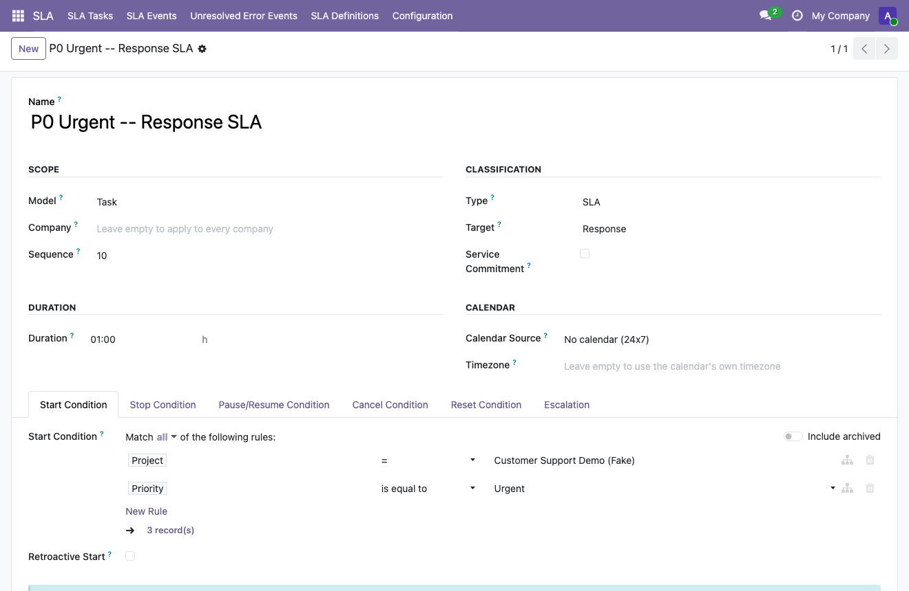
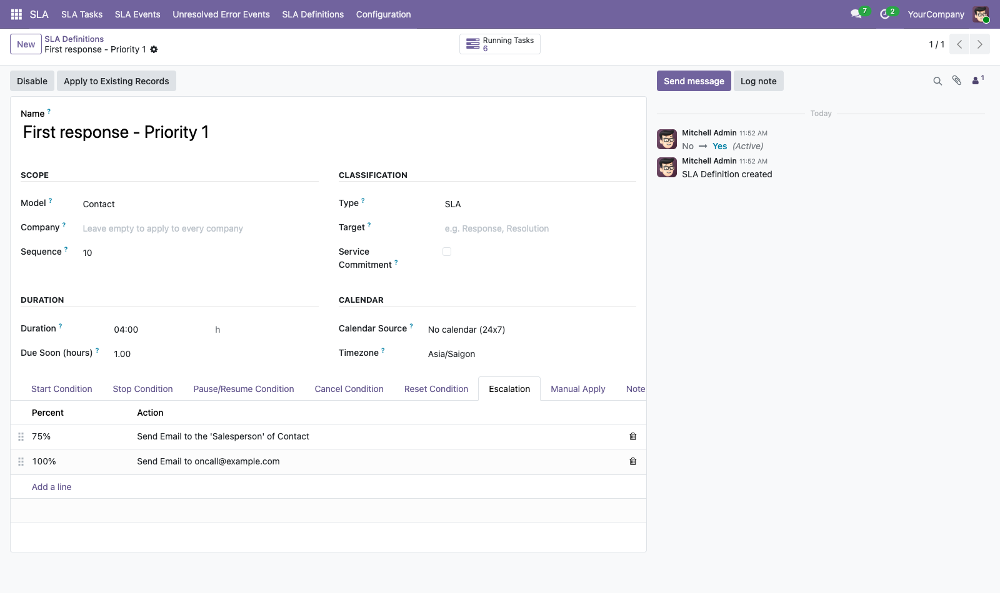
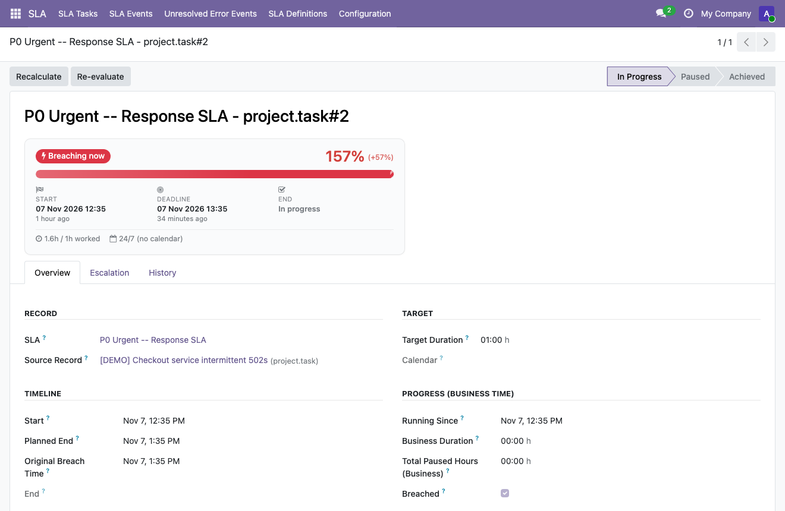
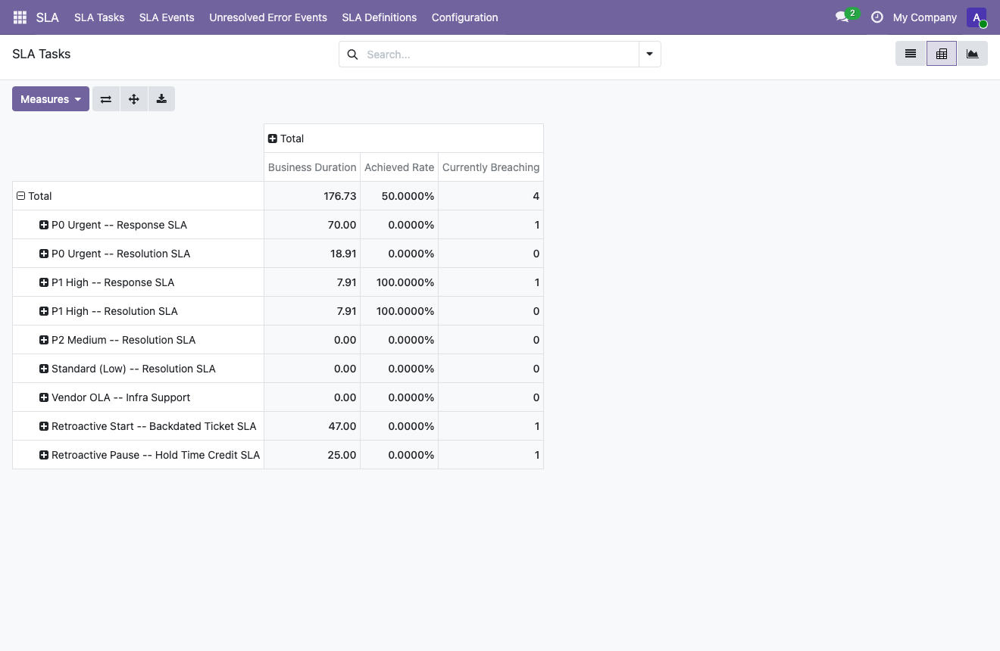

# SLA & Escalation — User Guide

How to configure, run and read Service Level Agreements on any Odoo model.
Applies to Odoo Community and Enterprise. Written for SLA Managers and SLA Users.

> This is the Markdown source of the in-app/App Store guide
> (`static/description/user_guide.html`). Keep the two in sync when either
> changes — the HTML copy is the store-facing one (ASCII entities, inline
> styles only, screenshots embedded); this one is the readable, repo-native
> copy for engineers and for anyone browsing `docs/`.

## Contents

1. [Overview & Key Concepts](#1-overview--key-concepts)
2. [Before You Begin](#2-before-you-begin)
3. [The SLA Lifecycle](#3-the-sla-lifecycle)
4. [The Six Conditions](#4-the-six-conditions)
5. [Create Your First SLA Definition](#5-create-your-first-sla-definition)
6. [Duration, Calendar & Timezone](#6-duration-calendar--timezone)
7. [Classification: SLA vs. OLA](#7-classification-sla-vs-ola)
8. [Escalation Rules](#8-escalation-rules)
9. [Smart Button on the Source Record](#9-smart-button-on-the-source-record)
10. [Retroactive Start & Retroactive Pause](#10-retroactive-start--retroactive-pause)
11. [Reading an SLA Task](#11-reading-an-sla-task)
12. [Event Log & Audit Trail](#12-event-log--audit-trail)
13. [Reporting](#13-reporting)
14. [Administration Settings](#14-administration-settings)
15. [Troubleshooting](#15-troubleshooting)
16. [Glossary](#16-glossary)
17. [Support](#17-support)

## 1. Overview & Key Concepts

SLA & Escalation measures and enforces time-bound commitments on **any model** in your Odoo database. You describe what
to watch and when with plain Odoo domain conditions; the module takes care of starting the clock, pausing and
resuming it, detecting a breach, running escalations and keeping a full history — with no code. Four terms come up
throughout this guide:

| Term | Meaning |
|---|---|
| **SLA Definition** | The configuration record: one model, six conditions, a target duration, a calendar and (optionally) escalation rules. Editing it never changes tasks already running — every task keeps the configuration it was created with. |
| **SLA Task** | One running (or finished) measurement, created automatically the moment a specific record matches an SLA Definition's Start Condition. A single record can have several tasks at once if it matches several definitions (for example a Response SLA and a Resolution SLA). |
| **Business time** vs. **wall-clock time** | Business time only counts hours inside the selected working calendar (used for the target duration and for deciding a breach). Wall-clock time counts every hour regardless of the calendar, shown separately for information. With no calendar selected the two are identical (a plain 24/7 clock). |
| **Breach** | Set the moment business time reaches the target duration while a task is still running. Once set, it is never cleared — even if the task is later paused or its deadline recomputed. |

## 2. Before You Begin

Two access groups control who can do what. Ask your administrator to add you to the right one from
**Settings → Users & Companies → Users**.

| Group | Can do |
|---|---|
| **SLA / User** | Read SLA Definitions, SLA Tasks and the Event Log. Enough to answer "why is this record late?" without being able to change how any SLA is configured. |
| **SLA / Manager** | Everything a User can do, plus create and edit SLA Definitions, run **Apply Current Settings** and **Re-check Conditions** on a task, and mark an error event resolved. |

You do not need to know Python. You do need to be comfortable with Odoo's own domain/filter builder (the same
widget used everywhere in Odoo to build a filter such as *Priority is Urgent*) — every SLA condition in this module
is written with exactly that widget.

## 3. The SLA Lifecycle

A background job checks every active task once a minute. Over its life, a task moves through this sequence:

1. **Attach.** A record starts matching the Start Condition → a task is created and the clock starts, either now or,
   with Retroactive Start, from a date already on the record.
2. **In Progress.** Business time accumulates. The deadline (Planned End) is computed from the start time, the
   target duration and the working calendar.
3. **Paused** (optional, repeatable). The record starts matching the Pause Condition → the clock stops. It resumes
   either when the Pause Condition stops matching, or when the Resume Condition matches, depending on Resume Mode.
4. **Breached** (if it happens). The moment business time reaches the target duration while still In Progress, the
   task is flagged breached. It keeps running — a breach does not stop a task.
5. **Stopped.** The record starts matching the Stop Condition → the task closes as **Achieved** (stopped before the
   deadline) or **Breached** (stopped at or after it).

Two conditions can end a task outside this normal path: **Cancel** (the task is discarded, not counted as achieved
or breached — typically because the record left the scope of the rule) and **Reset** (a tracked field changed in a
way that invalidates the current measurement; the previous task is cancelled or completed, and the record is
re-evaluated from scratch).

## 4. The Six Conditions

Every SLA Definition is built from up to six conditions, each a plain Odoo domain on the target model. An
empty condition, or the empty domain `[]`, means "not configured" and **never matches** (the domain editor labels `[]`
as "Match all records", but here it does not). To mean "every record", use an always-true rule such as
`[('id', '!=', 0)]`.

| Condition | Controls | Example |
|---|---|---|
| **Start** | When a task is created for a record. | `[('priority', '=', '3')]` — starts for urgent records only. |
| **Stop** | When a running task closes (Achieved/Breached). | `[('stage_id.is_closed', '=', True)]` |
| **Pause** | When a running task's clock stops. | `[('stage', '=', 'waiting_on_customer')]` |
| **Resume** | When a paused task's clock restarts (only used if Resume Mode is "When the resume condition matches"). | `[('stage', '!=', 'waiting_on_customer')]` |
| **Cancel** | When a running task is discarded instead of completed (only used if Cancel Mode is "When the cancel condition matches"). | `[('active', '=', False)]` |
| **Reset** | Together with the Reset Field list: which field changes should restart the measurement. | Reset Field = Priority, on a model where priority changing should re-qualify the record. |

> **Three mistakes to avoid** when writing conditions:
> 1. A Start Condition that is a *subset* of the Stop Condition — the SLA would never attach, because anything
>    matching Start already matches Stop.
> 2. A Pause Condition that is a subset of the Start Condition — the task attaches already paused, and is cancelled
>    the moment the pause ends (since by then it no longer matches Start either).
> 3. Start and Pause Conditions that are mutually exclusive in the wrong way — the task can be cancelled before it
>    ever gets the chance to pause.

Limit to keep in mind: a condition that reads a non-stored computed field, or one that reaches across a relation
(for example `partner_id.country_id`), is not automatically re-evaluated when only the related record changes. Use
the **Re-check Conditions** button on the task (or **Re-evaluate** on the error list for a batch) to refresh it on demand.
The **Note** tab of the definition form collects these limits and the common mistakes in one place.



*A Start Condition built entirely with Odoo's own domain editor — no code.*

## 5. Create Your First SLA Definition

1. Go to **SLA → SLA Definitions → New**.
2. Give it a clear **Name** — it is shown on every task it creates (for example "Ticket Response — Priority 1").
3. Pick the **Model** to watch. This can be any model installed in your database.
4. Under **Start Condition**, build the domain that defines which records this SLA applies to.
5. Under **Stop Condition**, build the domain that means "this record is done". Remember: Start must not be a subset of
   Stop (see the warning above).
6. Set the **Duration** (in hours) and, if you want business hours instead of a 24/7 clock, a **Calendar Source**
   (see section 6).
7. Save, then press **Enable**. A new definition starts **disabled** (a draft), so nothing is attached until you
   enable it. From then on, the next record that matches the Start Condition gets its own SLA Task automatically —
   no restart, no manual action. **Disable** stops attaching the SLA to new records; tasks that are already running
   keep running.
8. Records that existed before the definition was enabled do not get a task by themselves. Press **Apply to Existing
   Records** to attach the SLA to the ones that match the Start Condition (a first batch runs immediately, larger sets
   continue in the background; every run is listed in the **Manual Apply** tab).

The definition list shows disabled definitions greyed out; the toggle button on each row enables or disables it (it asks
for confirmation). Saving a change to the conditions of a definition that has running tasks asks for confirmation too,
because the new conditions apply to those tasks at their next evaluation. Changes to the important fields are
recorded in the chatter of the definition. The Model cannot be changed once a definition has tasks.

Pause/Resume, Cancel, Reset and Escalation are all optional and can be added later; a definition only needs a
Model, a Start Condition, a Stop Condition and a Duration to work.

## 6. Duration, Calendar & Timezone

| Calendar Source | Behaviour |
|---|---|
| **No calendar (24x7)** | Plain clock time, every hour counts, including nights, weekends and holidays. |
| **Fixed calendar on the definition** | Always uses the Working Calendar you pick on the definition (for example "Standard 40 hours/week"), regardless of the record. |
| **Calendar read from the record** | Follows a calendar found by walking a dot-separated path of Many2one fields from the record (Calendar Path), for example `partner_id.resource_calendar_id`. If any step is empty or the calendar cannot be used, the company's calendar is used, then plain 24/7 as a last resort. |

**Timezone** (on the Schedule section) lets you reuse one working calendar's hour pattern (say, 08:00–17:00) under a
different timezone for a specific SLA, without touching the original calendar or anything else that uses it. **Timezone is required** and always wins over the timezone stored on the calendar. It is filled in for you (the fixed
calendar's timezone when you pick one, otherwise your own); an existing value is never overwritten. When it differs
from the calendar's timezone, the module automatically creates (and reuses) a hidden copy of the calendar in that
timezone. The copy keeps the working hours and public holidays as they were when it was created and is **not** kept in
sync with the original calendar afterwards.

**Due Soon (hours)** (next to Duration) sets the "due soon" window for this SLA; leave it empty or 0 to use the value in
Settings. If it is equal to or longer than the Duration, every task is flagged Due Soon from the start.

## 7. Classification: SLA vs. OLA

These fields never change how the six conditions behave — they exist purely to organise and report on your
definitions.

| Field | Use |
|---|---|
| **Type** (SLA / OLA) | SLA: a commitment measured directly with an external customer. OLA: an internal commitment supporting a larger SLA, not shown to the customer. |
| **Target** (Response / Resolution) | Optional tag for filtering and grouping reports. |
| **Vendor** | The external vendor this OLA is measured against, for reporting, when it backs an Underpinning Contract. |
| **Service Commitment** | Tick for a definition that is an officially published commitment on a service contract, as opposed to an internal-only measure. |

## 8. Escalation Rules

1. Open the SLA Definition and go to the **Escalation** tab.
2. Click **Add a line**. Set the **Percent** of the target time at which it should run (a whole number > 0; a value
   above 100 fires after the deadline — for example 150 fires when the task has used one and a half times its
   target).
3. Pick the **Action Type**:
   - **Send Email** (the default — works out of the box, no setup beyond this rule) — then pick **Notify**:
     - **Responsible User/Partner on Record** (the default): point it at a User or Partner field on the record, for
       example "Assigned to" or "Customer"; the engine emails that person.
     - **Email Field on Record**: point it at a plain text field that already holds an email address, for example a
       "Customer Email" field.
     - **Fixed Email Address**: always notify the same address, for example a team distribution list.
   - **Run Server Action** (advanced) — pick any standard Odoo Server Action on the same model as the definition
     (post a message, call a method, send a custom-formatted email, etc.), for full control.
4. Stack as many rows as the process needs — each percentage fires once, independently.

If the action fails (a broken Server Action, a field pointing nowhere), the engine logs one **Escalate Failed**
event with the error and moves on — it does not retry. Transient failures aside, retrying an action that failed
once rarely succeeds on its own, so the Error Events screen (§14) is the place to catch and fix these, not a
background retry loop. Server Actions always run with the permissions of the background job's own user, never with
the permissions of whoever last edited the source record.



*A two-stage escalation: a 75% warning emailed to every assignee at once, then a 100% breach alert to a fixed on-call address.*

## 9. Smart Button on the Source Record

The SLA Progress widget (§10) lives on the SLA Task screen. To see SLA status without leaving the ticket, task or
any other record it is attached to, add a one-line smart button to that model's own form — no dependency on
`dwo_sla_core`'s own views required, just two small additions in the model you already customise:

```python
# your_module/models/your_model.py
class YourModel(models.Model):
    _name = 'your.model'
    _inherit = ['your.model', 'sla.mixin']
```

```xml
<!-- your_module/views/your_model_views.xml, inside <div class="oe_button_box"> -->
<button name="action_view_sla_tasks" type="object" class="oe_stat_button text-danger"
        icon="fa-exclamation-triangle" invisible="sla_task_breach_count == 0">
    <field name="sla_task_active_count" widget="statinfo" string="SLA"/>
</button>
<button name="action_view_sla_tasks" type="object" class="oe_stat_button"
        icon="fa-clock-o" invisible="sla_task_breach_count &gt; 0 or sla_task_active_count == 0">
    <field name="sla_task_active_count" widget="statinfo" string="SLA"/>
</button>
```

This gives a single button that shows the number of active SLA tasks and turns red the moment one of them is
breached — agents get a priority signal at a glance, without reading a number. Clicking it opens the record's SLA
tasks filtered to that record. The button only shows for users in the SLA User/Manager groups.

## 10. Retroactive Start & Retroactive Pause

By default, the clock starts the moment a task attaches. Tick **Retroactive Start** and pick a **Start-Marker
Field** (any Datetime field on the model, for example "Created on") to instead start the clock from a date already
on the record — useful when an SLA rule is added after records already exist, or when the real clock should start
earlier than the moment the rule matched (for example, a ticket's actual creation time rather than when it was
re-prioritised into scope). A backdated start can make a task breached the instant it attaches.

**Retroactive Pause** (on by default when Retroactive Start is used) avoids over-penalising a backdated task: it
looks at the record's own change history for the backdated window and credits any period where the Pause Condition
was already true, instead of counting that whole window as running time. For example:

> A ticket is retroactively started 40 hours in the past. Looking at its tracked field history, it was actually on
> hold (matching the Pause Condition) for 5 of those 40 hours before the rule even applied. With Retroactive Pause
> on, those 5 hours are credited: Total Paused Hours (Business) shows **05:00 h** and Business Duration is reduced
> accordingly, instead of counting the full 40 hours as time spent working the ticket.

Retroactive Pause only has an effect when the model, and every field used in the Pause Condition, are change-tracked
in Odoo (`mail.thread` with `tracking=True` fields). When they are not, the configuration screen shows a clear
warning explaining that the backdated window will be counted as running time instead — the SLA still works, it
simply cannot reconstruct a history that was never recorded.

## 11. Reading an SLA Task

Every task opens on an **SLA Progress** card that answers "where does this commitment stand?" at a glance:

| Badge | Meaning |
|---|---|
| **On Track** | In Progress, not breached, not due soon. |
| **Due Soon** | In Progress, not breached, deadline within the configured "Due Soon" window (see section 13). |
| **Breaching Now** | Past the deadline and still running (In Progress or Paused). |
| **Paused** | Clock stopped; resumes per the Resume Mode. |
| **Achieved** | Closed on or before the deadline. |
| **Completed Late** | Closed after the deadline. |
| **Cancelled** | Discarded; not counted as achieved or breached. |

The progress bar is always capped at 100% of the target so it stays readable; once a task runs far past its
deadline, the overrun is shown as a multiplier next to the percentage (for example "100% (70.0x over target)")
instead of a four- or five-digit number.



Below the card, the **Overview** tab groups every field the task carries:

| Group | Fields |
|---|---|
| **Record** | SLA (the definition), Source Record (the watched record, click to open it), Company. |
| **Target** | Target Duration, Calendar used. |
| **Timeline** | Start, Planned End (recomputed on resume), Original Breach Time (the deadline as first computed, never changed afterwards), End. |
| **Progress (Business Time)** | Running Since, Business Duration, Total Paused Hours (Business), Breached. |
| **Progress (Wall-clock Time)** | Paused Since, Duration, Total Paused Hours (Clock) — the same measurements in real elapsed hours, not excluding non-working time. |

SLA Managers see two buttons in the header (and in the header of the task list, for several tasks at once); both ask
for confirmation and write what they changed in the History tab:

| Button | What it changes |
|---|---|
| **Apply Current Settings** | The *configuration* of the task: copies the definition's current target duration, calendar and timezone onto it and recomputes the deadline from the moment you press the button. A task that has already breached keeps its deadline; a paused task only gets the new settings. |
| **Re-check Conditions** | The *state* of the task: checks the six conditions of **this** SLA again against the source record (other SLAs on the same record are not touched), for example after a condition was edited or a relation-crossing condition went stale. If the Reset condition matches, a new task is created. |

Finished and cancelled tasks are never changed by either button. The **Note** tab of the task explains both with
examples. The header also has **Open Source Record**.

On a record whose model has an SLA, a small **SLA status chip** appears next to the pager of the form (green running,
yellow due soon or paused, red late, grey met or missed). Click it to see the record's SLA tasks. It is shown only to
SLA users, can be turned off in Settings, and for a model that gets its first definition it appears after you reload the
page.

## 12. Event Log & Audit Trail

The **History** tab of a task, and the standalone **SLA Events** list, record every decision the engine made, with
a timestamp and (where relevant) a note explaining why.

| Event | Logged when |
|---|---|
| Attach | A task is created. |
| Pause / Resume | The clock stops or restarts. |
| Complete | The task closes as Achieved or Breached. |
| Cancel | The task is discarded. |
| Reset | A tracked field change invalidated the measurement and it restarted. |
| Breach | The deadline passes while the task is still running. |
| Escalate / Escalate Failed | An escalation (email or server action) ran, or failed. |
| Settings Applied | A manager pressed **Apply Current Settings** and the task changed (old and new values are in the note). |
| Conditions Re-checked | A manager pressed **Re-check Conditions** (the note says the old and new stage, or no change). |
| Error | The engine could not process this task (for example a broken condition); never blocks saving the source record. SLA Managers can mark these resolved from **Unresolved Error Events** once fixed. |

## 13. Reporting

SLA Tasks ship with ready-to-use List, Pivot and Graph views. Two measures are purpose-built for SLA reporting:

| Measure | Meaning |
|---|---|
| **Achieved Rate** | 1 for a task that ended on time, 0 for one that ended breached, empty while still running. Averaged over a group, it is the share of tasks achieved (0.8 = 80%). |
| **Currently Breaching** | 1 while a task is running or paused and already past its deadline, otherwise 0. Summed over a group, it is how many SLAs are in breach right now. |



## 14. Administration Settings

SLA Managers can tune these parameters from **Settings → SLA**:

| Setting | Default | Effect |
|---|---|---|
| Event Log Retention (days) | 365 | SLA events older than this are deleted automatically. |
| "Due Soon" Window (hours) | 4 | Size of the window used by the Due Soon badge and filter, for definitions that do not set their own Due Soon (hours). |
| Show SLA Status on Form View | On | Shows the SLA status chip next to the pager of records measured by an SLA. |
| Background Processing Batch Size | 50 | How many tasks the background job processes per run, so a large backlog is worked off over several runs instead of blocking. |

The background job itself needs no setup: it runs once a minute as a standard Odoo scheduled action (`ir.cron`),
visible like any other under **Settings → Technical → Scheduled Actions** for an administrator.

## 15. Troubleshooting

| Symptom | Likely cause & fix |
|---|---|
| No task is ever created for an SLA Definition. | First check that the definition is **enabled** (new ones start disabled) and that the Start Condition is not empty or `[]` (that never matches; use `[('id', '!=', 0)]` for every record). Otherwise the Start Condition is probably a subset of the Stop Condition — every record that could start already matches Stop. Widen Start or narrow Stop. |
| A task attaches already paused and is immediately cancelled. | The Pause Condition is a subset of the Start Condition. Make sure a record can match Start without also matching Pause. |
| A task's fields look stale after editing an unrelated record. | A condition reads a non-stored computed field or crosses a relation; those are not auto-refreshed. Use **Re-check Conditions**. |
| Retroactive Pause shows a warning and credits no time. | The model (or a field used in the Pause Condition) is not change-tracked in Odoo. The backdated window is counted as running time, same as with Retroactive Pause off. |
| An escalation did not run, or shows Escalate Failed. | Check the task's Event Log for the error note. For email: confirm the chosen field actually holds a value on that record (Notify = Responsible/Email Field reads live). For Server Action: confirm its model matches the SLA Definition's model. The engine does not retry automatically — fix the configuration, then use **Re-check Conditions** or wait for the next threshold. |
| I changed a definition's Duration but existing tasks did not change. | By design — a task snapshots its configuration when it attaches. Use **Apply Current Settings** on the task, or wait for it to complete and let the next one pick up the new value. |

## 16. Glossary

| Term | Definition |
|---|---|
| **Business time** | Elapsed time counted only during the hours of the applicable working calendar. |
| **Breach** | The deadline has passed while a task was still active; never cleared once set. |
| **Escalation** | An email or Server Action fired automatically once a task reaches a configured percentage of its target. |
| **OLA** | Operational Level Agreement — an internal commitment supporting a customer-facing SLA. |
| **Planned End** | The current computed deadline; recomputed on resume or Apply Current Settings. |
| **Original Breach Time** | The deadline as first computed when the task attached, kept unchanged afterwards. |
| **Retroactive Start** | Starting the clock from a date already on the record, instead of the moment the task attaches. |
| **Retroactive Pause** | Crediting a backdated window with any hold time already visible in the record's change history. |
| **Wall-clock time** | Elapsed real time, not excluding non-working hours. |

## 17. Support

Questions about configuring a rule, or something that does not match this guide? Write to
[hello@duotek.io.vn](mailto:hello@duotek.io.vn) with your Odoo version, the SLA Definition involved, and
what you expected to happen.
